# GAMIFICATION MODEL (D1)
**Typing Trainer — Windows Desktop Application**
*Document Version: 1.0.0 | Stage: D1 Architecture*

---

## 1. Gamification Philosophy: "Skill Mastery over Meaningless Grind"

Traditional gamification often rewards sheer time investment or repetitive button mashing. In Typing Trainer, gamification is designed as **Serious Gamification**:
- **Accuracy is Paramount:** Mashing keys quickly with 80% accuracy reinforces negative muscle memory. The reward system penalizes sloppy speed and heavily multiplies deliberate, accurate typing.
- **No Vanity Metrics:** Progression must correlate with demonstrable typing fluency and physical ergonomic consistency.
- **Distraction-Free:** Progression feedback is subtle during active typing and celebrated during natural resting pauses (Results and Dashboard screens).

---

## 2. Experience Points (XP) Engine & Mathematical Formulation

### 2.1 The Core Session XP Formula
XP is awarded upon session completion based on Net Speed ($WPM_{net}$), duration ($t$ in minutes), and an **Accuracy Multiplier** ($M_{acc}$):

$$XP_{earned} = \max\left(0, \; \text{round}\left( WPM_{net} \times t_{minutes} \times M_{acc} \times B_{streak} \right)\right)$$

### 2.2 Accuracy Multiplier ($M_{acc}$) Table
To prevent rapid key-mashing exploits, the multiplier decays steeply below 95% and turns to zero below 85%:

| Accuracy Bracket | Multiplier ($M_{acc}$) | Designation | Rationale |
|---|---|---|---|
| **$99.0\% - 100\%$** | **$1.50\times$** | Flawless Mastery | Top-tier precision reward. |
| **$97.0\% - 98.9\%$** | **$1.20\times$** | High Precision | Standard recommended target bracket. |
| **$95.0\% - 96.9\%$** | **$1.00\times$** | Baseline Competence | Acceptable touch-typing standard. |
| **$90.0\% - 94.9\%$** | **$0.50\times$** | Erratic / Degraded | Severe XP penalty for carelessness. |
| **$85.0\% - 89.9\%$** | **$0.20\times$** | Spamming Warning | Nominal token XP; prompt to slow down. |
| **$< 85.0\%$** | **$0.00\times$** | Zero Credit | Invalidates session for XP and streaks. |

*Example:*
- User A types 80 WPM for 1 minute at 98% accuracy: $80 \times 1.0 \times 1.20 = \mathbf{96\text{ XP}}$.
- User B mashes 110 WPM for 1 minute at 86% accuracy: $110 \times 1.0 \times 0.20 = \mathbf{22\text{ XP}}$.
- *Result:* Accurate typing yields over $4\times$ the XP of reckless speed.

### 2.3 Streak Bonus Multiplier ($B_{streak}$)
Consistent daily practice compounds rewards:
- Day 1–3: $1.00\times$
- Day 4–7: $1.05\times$
- Day 8–14: $1.10\times$
- Day 15–30: $1.15\times$
- Day 31+: $1.20\times$ (Cap to prevent runaway inflation)

---

## 3. Levels & Mastery Tiers Structure

The progression ladder spans **Levels 1 to 100**, divided into 6 prestigious Mastery Tiers.

```
+-----------------------------------------------------------------------------+
|                            MASTERY TIER LADDER                              |
+-----------------------------------------------------------------------------+
|                                                                             |
|  [TIER 6] GRANDMASTER      (Lvl 81–100)  •  120+ WPM, 99% Acc, Developer God|
|  [TIER 5] KEYSTROKE PRO    (Lvl 61–80)   •  100+ WPM, Flawless Rhythm       |
|  [TIER 4] TOUCH TYPIST     (Lvl 41–60)   •  75+ WPM, Complete Independence  |
|  [TIER 3] JOURNEYMAN       (Lvl 21–40)   •  50+ WPM, Reliable Home Row      |
|  [TIER 2] APPRENTICE       (Lvl 11–20)   •  35+ WPM, Finger Form Familiar   |
|  [TIER 1] NOVICE           (Lvl 1–10)    •  Foundational Touch-Typing       |
|                                                                             |
+-----------------------------------------------------------------------------+
```

### 3.1 Tier Classification & Thresholds

| Tier Name | Level Range | Cumulative XP Required | Minimum Benchmark Gate | Visual Badge Aesthetic |
|---|---|---|---|---|
| **Tier 1: Novice** | Levels 1–10 | 0 – 3,500 XP | Complete Module 1 | Matte Slate / Bronze |
| **Tier 2: Apprentice** | Levels 11–20 | 3,501 – 12,000 XP | 35 WPM @ 95% Acc | Brushed Steel / Silver |
| **Tier 3: Journeyman** | Levels 21–40 | 12,001 – 45,000 XP | 50 WPM @ 96% Acc | Polished Cobalt / Gold |
| **Tier 4: Touch Typist** | Levels 41–60 | 45,001 – 110,000 XP | 75 WPM @ 97% Acc | Luminous Cyan / Platinum |
| **Tier 5: Keystroke Pro** | Levels 61–80 | 110,001 – 240,000 XP | 100 WPM @ 98% Acc | Electric Emerald / Diamond |
| **Tier 6: Grandmaster** | Levels 81–100 | 240,001 – 500,000 XP | 120 WPM @ 99% Acc | Obsidian Holographic Crest |

### 3.2 Level XP Scaling Formula
XP required for level $L$ follows a gentle quadratic curve:

$$XP_{required}(L) = \text{round}\left( 120 \times L^{1.35} \right)$$

---

## 4. Daily Practice Goals & Streak Habit Loops

### 4.1 Daily Practice Goal
Users configure their daily goal during onboarding (adjustable in Settings):
- **Casual:** 5 minutes or 300 words per day.
- **Standard (Recommended):** 15 minutes or 1,000 words per day.
- **Intensive:** 30 minutes or 2,500 words per day.

Upon meeting the daily threshold:
1. The circular progress ring on the Dashboard completes with a satisfying chime.
2. The user is awarded a daily completion bonus of **+150 XP**.
3. The day's square on the Streak Calendar lights up with an active green glow.

### 4.2 Streak Mechanics & "Streak Freeze" Shields
- A streak increments when the daily practice goal is met before midnight local time.
- **The Problem with Harsh Streaks:** Life happens. Losing a 60-day streak due to travel causes users to abandon the app entirely.
- **The Solution (Streak Freeze Shields):**
  - Users earn 1 **Streak Freeze Shield** for every 7 consecutive days of practice with $\ge 96\%$ average accuracy.
  - Maximum inventory: 2 Freeze Shields.
  - If a user misses a day, a Freeze Shield is automatically consumed, preserving the streak count without penalty.

---

## 5. Achievement & Badge Taxonomy

Achievements are divided into 5 distinct categories, encouraging diverse practice styles:

```mermaid
graph TD
    Achievements["Typing Trainer Trophy Cabinet"]
    
    Achievements --> Speed["01. Speed Milestones\n(Raw Velocity)"]
    Achievements --> Accuracy["02. Accuracy Paragons\n(Precision & Rhythm)"]
    Achievements --> Dedication["03. Endurance & Dedication\n(Habit & Volume)"]
    Achievements --> Developer["04. Developer Prowess\n(Syntax Mastery)"]
    Achievements --> Secret["05. Mastery & Special Feats\n(Ergonomic Trophies)"]
    
    Speed --> S1["The Sound Barrier (100 WPM)"]
    Speed --> S2["Supersonic (120 WPM)"]
    Speed --> S3["Hyperdrive (140+ WPM)"]
    
    Accuracy --> A1["Scalpel (100% on 60s Test)"]
    Accuracy --> A2["Metronome (90%+ Consistency)"]
    Accuracy --> A3["Zen Master (Zero Backspaces)"]
    
    Dedication --> D1["Habitual (7 Day Streak)"]
    Dedication --> D2["Centurion (100 Tests Completed)"]
    Dedication --> D3["Iron Fingers (100,000 Words)"]
    
    Developer --> DEV1["Polyglot (Complete 5 Languages)"]
    Developer --> DEV2["Bracket Ninja (99% Symbol Acc)"]
    Developer --> DEV3["Bash Commando (Terminal Sprints)"]
    
    Secret --> SEC1["Blind Typist (Screen Blank Mode)"]
    Secret --> SEC2["Keyboard Smith (Custom Layout Test)"]
```



### 5.1 Highlighted Achievement Definitions

| Badge Name | Category | Exact Unlock Requirement | XP Bounty |
|---|---|---|---|
| **First Contact** | Dedication | Complete your first benchmark test. | +50 XP |
| **Home Row Graduate** | Mastery | Pass Module 1 assessment with $\ge 95\%$ accuracy. | +200 XP |
| **The Sixty-Club** | Speed | Achieve $\ge 60\text{ WPM}$ on a standard 60s test. | +300 XP |
| **Triple Digits** | Speed | Achieve $\ge 100\text{ WPM}$ on a standard 60s test. | +1,000 XP |
| **The Surgeon** | Accuracy | Complete a 60s test with $100\%$ accuracy and $\ge 70\text{ WPM}$. | +1,500 XP |
| **Iron Will** | Dedication | Maintain a 30-day practice streak. | +2,500 XP |
| **Full Stack Typist** | Developer | Type 1,000 lines of code across TypeScript, Python, and Rust. | +1,200 XP |
| **Zero Panic** | Accuracy | Finish a 120s test without making more than 1 mistake. | +800 XP |

---

## 6. Anti-Grind & Integrity Architecture

To maintain the legitimacy of achievements and leaderboards, Typing Trainer implements local anti-exploit rules:

1. **Short Test Diminishing Returns:** Tests under 15 seconds grant maximum 25 XP to prevent spamming ultra-short runs.
2. **Copy-Paste & Synthetic Input Blocking:** Keystrokes must be produced via authentic hardware keyboard input events. Any automated or simulated input with uniform 0ms inter-keystroke intervals is flagged and disregarded from personal records.
3. **Accuracy Gate on Achievements:** Speed achievements (such as *Triple Digits 100 WPM*) are strictly invalidated if accuracy on that run is $< 96\%$. Speed without precision is not recognized as mastery.
4. **Offline Integrity:** All statistics and achievements are cryptographically hashed in local SQLite storage to prevent casual external tampering.
