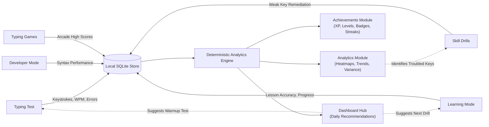

# INFORMATION ARCHITECTURE (D1)
**Typing Trainer — Windows Desktop Application**
*Document Version: 1.0.0 | Stage: D1 Architecture*

---

## 1. Overview & Information Organization Principles

The information architecture of Typing Trainer is structured to support two distinct operating mindsets:
1. **Flow & Practice Mode (Action-First):** Typists wanting instant access to a test, drill, or coding challenge with zero friction.
2. **Review & Mastery Mode (Reflection-First):** Users reviewing performance analytics, checking curriculum progress, tweaking ergonomic layouts, or inspecting achievements.

To balance these needs, the architecture uses a **shallow hierarchy** (maximum depth of 3 levels from root) anchored by an omni-accessible desktop sidebar and a keyboard-driven command palette (`Ctrl + K`).

---

## 2. Global Structural Hierarchy

```mermaid
graph TD
    AppRoot["Typing Trainer Desktop App"]

    %% Core Branches
    AppRoot --> Dashboard["01. Dashboard Hub"]
    AppRoot --> TypingTest["02. Typing Test (The Arena)"]
    AppRoot --> LearningMode["03. Learning Mode (Academy)"]
    AppRoot --> Exercises["04. Skill Drills & Exercises"]
    AppRoot --> TypingGames["05. Typing Games (Arcade)"]
    AppRoot --> DeveloperMode["06. Developer Mode (Code Studio)"]
    AppRoot --> Analytics["07. Analytics & Progress"]
    AppRoot --> Achievements["08. Achievements & Streaks"]
    AppRoot --> Settings["09. Settings & Preferences"]

    %% Dashboard Sub-nodes
    Dashboard --> QuickPractice["Daily Practice Kickoff"]
    Dashboard --> StreakStatus["Streak & Goal Tracker"]
    Dashboard --> RecentHistory["Recent Sessions Overview"]

    %% Typing Test Sub-nodes
    TypingTest --> TimedMode["Time Sprints (15s, 30s, 60s, 120s)"]
    TypingTest --> WordMode["Word Counts (10, 25, 50, 100)"]
    TypingTest --> QuoteMode["Quotes (Short, Medium, Long)"]
    TypingTest --> ZenMode["Zen Endless Typing"]
    TypingTest --> TestSession["Active Typing Canvas"]
    TestSession --> SessionResults["Test Performance Summary"]

    %% Learning Mode Sub-nodes
    LearningMode --> CurriculumOverview["Touch-Typing Roadmap"]
    LearningMode --> ModuleHomeRow["Module 1: Home Row Foundations"]
    LearningMode --> ModuleTopRow["Module 2: Top Row & Reaches"]
    LearningMode --> ModuleBottomRow["Module 3: Bottom Row Coordination"]
    LearningMode --> ModuleNumbers["Module 4: Numbers & Symbols"]
    LearningMode --> LessonDrill["Interactive Lesson Stage"]
    LessonDrill --> LessonMastery["Lesson Completion & Feedback"]

    %% Exercises Sub-nodes
    Exercises --> WeakKeyDrill["Targeted Weak-Key Remediation"]
    Exercises --> NgramDrill["N-Grams / Bigrams Practice"]
    Exercises --> VocabularyDrill["Top 1000 Most Common Words"]
    Exercises --> CustomTextDrill["Custom File / Text Import"]

    %% Games Sub-nodes
    TypingGames --> FallingWords["Falling Words (Reflex Defense)"]
    TypingGames --> TimeAttack["Time Attack (Sprint Challenge)"]
    TypingGames --> WordScramble["Word Scramble (Decryption)"]

    %% Developer Mode Sub-nodes
    DeveloperMode --> LanguageSelector["Language Catalog (10+ Languages)"]
    DeveloperMode --> SyntaxTypingStage["Code Block Typing Canvas"]
    DeveloperMode --> CustomCodeImport["Custom Snippet Importer"]

    %% Analytics Sub-nodes
    Analytics --> SpeedTrends["Speed & WPM Timeline"]
    Analytics --> AccuracyAnalysis["Accuracy & Error Variance"]
    Analytics --> KeyboardHeatmap["Interactive Keyboard Heatmap"]
    Analytics --> SessionLog["Historical Session Log Explorer"]

    %% Achievements Sub-nodes
    Achievements --> TrophyCabinet["Badges & Trophy Showcase"]
    Achievements --> LevelMilestones["Level Progression & Tier Ladder"]
    Achievements --> StreakCalendar["Daily Streak Calendar"]

    %% Settings Sub-nodes
    Settings --> PrefGeneral["General & System Settings"]
    Settings --> PrefKeyboard["Keyboard Layout & Finger Guide"]
    Settings --> PrefAppearance["Theme & Typography Styling"]
    Settings --> PrefAudio["Audio & Mechanical Sound Studio"]
    Settings --> PrefData["Local SQLite Data Backup & Export"]
```



---

## 3. Primary vs. Secondary Navigation Structure

### 3.1 Primary Navigation (Desktop Sidebar)
The Primary Navigation is permanently accessible on the left edge of the desktop window. It groups the application into 3 cohesive clusters:

| Cluster | Primary Nav Item | Routing Path | Primary Purpose |
|---|---|---|---|
| **Overview** | **Dashboard** | `/dashboard` | Daily launchpad, streak status, quick action, personal bests. |
| **Practice Arenas** | **Typing Test** | `/test` | Standard timed and word-count speed runs. |
| | **Learning Mode** | `/learning` | Structured, progressive touch-typing curriculum. |
| | **Skill Drills** | `/drills` | Targeted exercises: weak keys, n-grams, vocabulary. |
| | **Developer Mode** | `/developer` | Realistic programming syntax & terminal drills. |
| | **Typing Games** | `/games` | High-tempo arcade challenges for reactive speed. |
| **Insights & System** | **Analytics** | `/analytics` | Deep performance telemetry, heatmaps, and logs. |
| | **Achievements** | `/achievements` | Badges, streaks, XP level milestones, and trophies. |
| | **Settings** | `/settings` | Layouts, audio, themes, preferences, local data. |

### 3.2 Secondary Navigation (In-Module Sub-Tabs & Segments)
Within each primary module, secondary navigation uses horizontal segmented controls or sub-tabs:

1. **Typing Test Module:**
   - `[ Mode: Time | Words | Quote | Zen | Custom ]`
   - `[ Options: Duration (15, 30, 60, 120) | Punctuation (On/Off) | Numbers (On/Off) ]`
2. **Learning Mode Module:**
   - `[ Roadmap View | Module 1: Home Row | Module 2: Top Row | Module 3: Bottom Row | Module 4: Numbers/Symbols ]`
3. **Skill Drills Module:**
   - `[ Weak Keys | Common Bigrams | Top 1000 Words | Custom Text Import ]`
4. **Developer Mode Module:**
   - `[ Language: TypeScript | Java | Python | Rust | Go | SQL | Bash | HTML/CSS ]`
   - `[ Level: Keywords | Idiomatic Snippets | Full Functions ]`
5. **Analytics Module:**
   - `[ Overview Trends | Speed Curve | Accuracy & Errors | Keyboard Heatmap | Session Log ]`
6. **Achievements Module:**
   - `[ All Trophies | Unlocked (18) | In Progress (7) | Locked (15) | Streak Calendar ]`
7. **Settings Module:**
   - `[ General | Typing Engine | Keyboard Layout | Appearance & Themes | Audio Simulation | Data & Privacy ]`

---

## 4. Module Interrelationships & Data Flows

Typing Trainer is built on a unified local data model. The modules are not siloed; they feed into and reinforce one another:



### 4.1 Key Behavioral Loops:
- **The Weak-Key Closed Loop:** Keystroke errors made in *Typing Test*, *Learning Mode*, or *Developer Mode* are aggregated into the user's local keystroke error matrix. When the user opens *Skill Drills*, the "Weak-Key Remediation" generator automatically produces targeted drills focusing on those exact stumbling blocks.
- **The Dashboard Recommendation Loop:** The Dashboard dynamically computes the next best action:
  - If a daily streak is at risk $\rightarrow$ "Quick 60s Daily Streak Warmup".
  - If error rate on the pinky reach is $> 8\%$ $\rightarrow$ "Module 2: Pinky Reach Drill".
  - If accuracy on the last 3 tests is $\ge 98\%$ $\rightarrow$ "Step Up: Attempt Speed Attack".

---

## 5. Global Actions, Utilities & Command Palette

To ensure seamless keyboard navigation, the application provides persistent global utilities:

```
+-----------------------------------------------------------------------------+
|                          GLOBAL COMMAND PALETTE                             |
|  [ Ctrl + K ]                                                               |
+-----------------------------------------------------------------------------+
|  > Type a command or search...                                              |
|                                                                             |
|  Navigation:                                                                |
|    Go to Typing Test                       [ G then T ]                     |
|    Go to Learning Mode                     [ G then L ]                     |
|    Go to Developer Mode                    [ G then D ]                     |
|    Go to Analytics                         [ G then A ]                     |
|                                                                             |
|  Quick Actions:                                                             |
|    Start 60s Benchmark Test                [ Enter ]                        |
|    Practice Weak Keys                      [ W ]                            |
|    Toggle Mechanical Sound Effects         [ M ]                            |
|    Switch to Dark / Light Theme            [ T ]                            |
|    Reset Current Session                   [ Tab + Enter ]                  |
+-----------------------------------------------------------------------------+
```

### 5.1 Global Accelerator Map
- `Ctrl + K`: Open Command Palette / Quick Jumper.
- `Tab + Enter`: Instant restart of active session with fresh passage.
- `Esc`: Pause active typing test / dismiss modal / return to parent level.
- `Ctrl + B`: Collapse or expand sidebar navigation.
- `Ctrl + Shift + T`: Toggle between Light and Dark themes.
- `Ctrl + Shift + M`: Mute or unmute mechanical typing audio simulation.
- `F11`: Toggle Fullscreen / Zen Typing Mode.

---

## 6. Information Architecture Assessment & Improvements

### Evaluation of the Initial 9 Modules:
The original proposal listed 9 separate items: *1. Dashboard, 2. Typing Test, 3. Learning Mode, 4. Exercises, 5. Typing Games, 6. Developer Mode, 7. Analytics, 8. Achievements, 9. Customization/Settings.*

**Architectural Refinement Applied:**
1. **Clarified Boundary Between "Learning Mode" and "Exercises":**
   - *Learning Mode (Academy)* is strictly structured, sequential, linear touch-typing pedagogy (from zero touch typing to finger independence).
   - *Skill Drills / Exercises* is modular, non-linear, functional practice (targeted weak-key drills, high-frequency word lists, and custom text imports).
2. **Elevated Developer Mode as a Distinct Core Pillar:**
   - Programming syntax requires fundamentally different caret rules (indentation skipping, bracket balancing, symbol highlighting) that must not be diluted into general prose exercises.
3. **Harmonized Analytics and Achievements:**
   - Analytics represents raw objective telemetry (numbers, heatmaps, statistical charts).
   - Achievements represents the gamified psychological layer (XP, streaks, trophies, badges). Keeping them distinct avoids cluttering analytical graphs with gamified flair.
