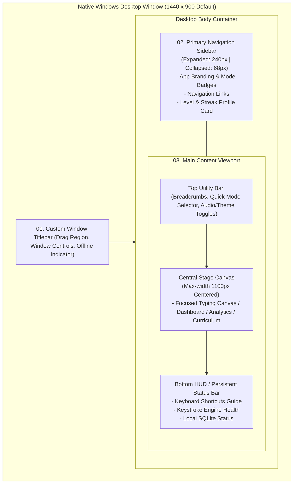

# NAVIGATION MODEL (D1)
**Typing Trainer — Windows Desktop Application**
*Document Version: 1.0.0 | Stage: D1 Architecture*

---

## 1. Desktop Shell Architecture & Layout Anatomy

Typing Trainer is built as a native Windows desktop experience utilizing Tauri 2. The desktop shell is designed to provide maximum focus for typing while offering persistent, low-friction navigation between learning modules, telemetry tools, and settings.

### 1.1 Structural Anatomy Diagram



---

## 2. Shell Components Specification

### 2.1 Component 1: Custom Windows Window Titlebar
Windows desktop applications require clear native integration (minimize, maximize/restore, close) while preserving custom brand aesthetics:
- **Height:** 36px fixed.
- **Drag Region:** Tauri window drag enabled across entire empty space (`data-tauri-drag-region`).
- **Left Edge:** 16px brand glyph, app title ("Typing Trainer"), and an "Offline-Ready" indicator dot (Green `#10B981` = Local SQLite Connected).
- **Center:** Quick Search / Command Palette shortcut trigger pill (`Ctrl + K`).
- **Right Edge:** Native Windows control buttons (Minimize, Maximize, Close) styled to match Windows 11 Fluent design specifications with proper hover/active states.

### 2.2 Component 2: Primary Navigation Sidebar
The left sidebar provides access to all top-level destinations.

```
+-------------------------------------------------------------+
| EXPANDED (240px)               | COLLAPSED (68px)           |
+-------------------------------------------------------------+
| [⌨] TYPING TRAINER             | [⌨]                        |
|                                |                            |
| OVERVIEW                       |                            |
|   [📊] Dashboard               |   [📊] (Tooltip)           |
|                                |                            |
| PRACTICE                       |                            |
|   [⚡] Typing Test  (ACTIVE)   |   [⚡] (Active Indicator)  |
|   [🎓] Learning Mode           |   [🎓] (Tooltip)           |
|   [🎯] Skill Drills            |   [🎯] (Tooltip)           |
|   [💻] Developer Mode          |   [💻] (Tooltip)           |
|   [🎮] Typing Games            |   [🎮] (Tooltip)           |
|                                |                            |
| MASTERY                        |                            |
|   [📈] Analytics               |   [📈] (Tooltip)           |
|   [🏆] Achievements            |   [🏆] (Tooltip)           |
|   [⚙] Settings                 |   [⚙] (Tooltip)           |
|                                |                            |
| USER PROFILE                   | USER                       |
|   [●] Level 14 Typist          |   [●] (Avatar Ring)        |
|   🔥 7 Day Streak              |   🔥 7                     |
|   [============ ] 68% XP       |                            |
|   [ < Collapse ]               |   [ > Expand ]             |
+-------------------------------------------------------------+
```

#### Detailed Behavior:
- **Expanded Width:** 240px. Displays category section headers, icons, text labels, and active route markers.
- **Collapsed Width:** 68px (Icon Rail). Replaces text labels with high-contrast icons, maintaining accessibility through instant hover tooltips displaying the destination name and keyboard shortcut.
- **Toggle Mechanism:** Dedicated collapse button at the bottom of the sidebar, or universal shortcut `Ctrl + B`.
- **State Persistence:** Sidebar state (`isCollapsed: boolean`) is stored locally in user preferences and restored across launches.
- **Active State Styling:**
  - Background: Primary accent tint at 15% opacity (`rgba(59, 130, 246, 0.15)`).
  - Left border indicator: 3px solid primary blue (`#3B82F6`).
  - Text & Icon: Crisp high-contrast white (`#FFFFFF`) with font weight `Semi-Bold`.
  - Inactive State: Muted slate (`#94A3B8`) shifting to `#E2E8F0` on hover.

### 2.3 Component 3: Top Utility Bar
Located at the top of the main content region:
- **Left:** Dynamic contextual breadcrumbs (`Typing Test / 60s English Benchmark`).
- **Center:** Quick Mode Selector Pill (visible in Test and Drill views) allowing one-click switching between test modes without navigating away.
- **Right Utilities:**
  - Mechanical Audio Toggle (Headphones icon: switches between Cherry MX Blue, Brown, Red, or Mute).
  - Keyboard Layout Tag (e.g., `QWERTY • US`).
  - Theme Mode Toggle (`Sun` / `Moon` icon: instant switch between Dark and Light themes).
  - Zen Mode / Fullscreen Toggle (`F11` trigger).

### 2.4 Component 4: Main Content Region (The Canvas)
- **Fluid & Constrained Layout:** The central canvas is fluid with a maximum container width of `1100px` for optimal visual ergonomics during reading and typing.
- **Distraction Reduction:** During active typing, peripheral UI elements (sidebar navigation, utility bar icons) automatically transition to 20% opacity. Any mouse movement or pressing `Esc` instantly restores full visibility.

### 2.5 Component 5: Bottom Status & Notification Bar
- **Height:** 32px.
- **Left:** Keyboard navigation hints (`[Tab + Enter] Restart`, `[Esc] Pause`, `[Ctrl + K] Menu`).
- **Center:** Non-intrusive notification pill for newly unlocked badges or streak saves.
- **Right:** Local persistence indicator (`SQLite: Synced • 0ms Latency`).

---

## 3. Keyboard-First Navigation & Accelerator Architecture

Typing Trainer is fundamentally a keyboard-centric application. Users should never be forced to reach for a mouse to navigate.

### 3.1 Accelerator System Table

| Key Combination | Scope | Action |
|---|---|---|
| `Ctrl + K` | Global | Opens Command Palette search overlay. |
| `Ctrl + B` | Global | Toggles Sidebar (Expanded $\longleftrightarrow$ Collapsed). |
| `Ctrl + Shift + T` | Global | Toggles Visual Theme (Dark $\longleftrightarrow$ Light). |
| `Ctrl + Shift + M` | Global | Toggles Mechanical Key Audio (Mute / Unmute). |
| `Ctrl + 1` to `Ctrl + 9` | Global | Direct jump to primary sidebar modules (1: Dashboard ... 9: Settings). |
| `Tab + Enter` | Typing / Drill | Instant restart of current test or lesson with fresh passage. |
| `Esc` | Typing / Drill | Pauses test, opens session menu, or closes active modal. |
| `F11` | Global | Toggles Fullscreen Zen Mode (hides sidebar, titlebar, and HUD). |
| `Ctrl + ,` | Global | Direct jump to Settings. |

### 3.2 Focus Ring & Tab Navigation Rules
- **Explicit Focus Order:** Pressing `Tab` moves through controls in strict visual reading order: Mode Selector $\rightarrow$ Option Pills $\rightarrow$ Action Buttons.
- **Typing Focus Lock:** When a typing session is primed, keyboard focus is automatically locked to the typing canvas. Normal browser key behaviors (such as spacebar scrolling or backspace page navigation) are strictly prevented.
- **Visible Focus States:** Focus rings adhere strictly to Windows accessibility standards: a 2px offset ring with high-contrast color (`#3B82F6` in dark mode, `#2563EB` in light mode).

---

## 4. Toast Notifications & Achievement Feeds

To preserve uninterrupted flow states, feedback is strictly partitioned:
1. **Never Interrupt Keystrokes:** No modal or popup will ever interrupt an active typing test or drill.
2. **Deferred Toast Queue:** If an achievement or level-up is achieved mid-test, the event is queued silently.
3. **Completion Unfurl:** The celebration banner or badge unlock is displayed smoothly on the **Results Screen** once the session completes, where the user has natural cognitive downtime.

---

## 5. Justification of Navigation Decisions

| Design Decision | Alternative Considered | Rationale for Chosen Decision |
|---|---|---|
| **Collapsible Left Sidebar** | Top Horizontal Navbar | The desktop viewport (16:9 or 16:10 widescreen) has ample horizontal space. A horizontal top bar consumes precious vertical space needed for multi-line text streams, visual keyboards, and charts. |
| **Command Palette (`Ctrl + K`)** | Deep nested flyout menus | Typists are keyboard-native. Typing `Ctrl + K` + `dev` + `Enter` takes 400ms, whereas mouse navigation through multi-level menus takes 2500ms. |
| **Soft Dimming during Typing** | Hard Fullscreen Transition | Hard transitions disorient users. Soft dimming (lowering opacity of sidebar and titlebar to 20%) maintains spatial awareness while eliminating peripheral eye-catchers. |
| **Non-blocking Toast Queue** | Immediate Mid-Test Alerts | Popping an achievement dialog while typing ruins accuracy and breaks personal records. Queueing to the results screen respects the user's focus. |
