# USER JOURNEYS (D1)
**Typing Trainer — Windows Desktop Application**
*Document Version: 1.0.0 | Stage: D1 Architecture*

---

## 1. Overview of Core User Journeys

This document defines the 12 foundational end-to-end user journeys for Typing Trainer. Each journey maps the cognitive flow, decision nodes, edge cases, and post-conditions to ensure flawless desktop interaction.

---

## 2. Journey 1: First Application Launch

- **Trigger:** User installs the application and runs Typing Trainer for the very first time.
- **User Goal:** Launch the app, confirm it works offline, and land into a friendly initial setup without confusion.

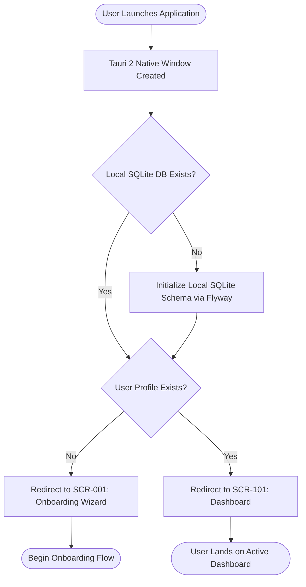

- **Key Decision Points:** Detecting whether the database exists in the local Windows AppData directory without requiring user admin privileges.
- **Edge Cases:** If SQLite database lock or file permission issue occurs, display friendly local troubleshooting card explaining folder permissions.
- **Post-Condition:** SQLite database initialized, window size maximized or restored to 1440x900.

---

## 3. Journey 2: Initial Onboarding

- **Trigger:** User enters `SCR-001` following first launch.
- **User Goal:** Set up primary preferences (keyboard layout, typing skill level, daily practice goal) and establish baseline WPM.

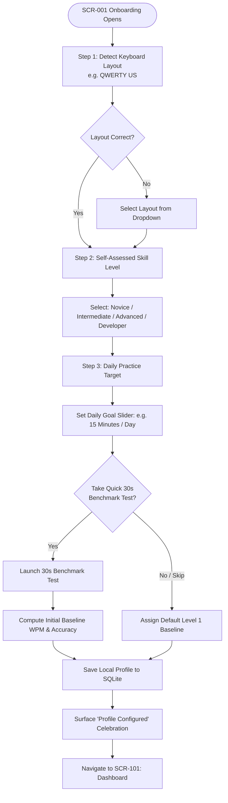

- **Key Decision Points:** Allowing the user to skip the benchmark test immediately if they want to explore first.
- **Post-Condition:** Profile stored locally with initial baseline metrics; daily streak initialized to Day 1.

---

## 4. Journey 3: Starting a Typing Test

- **Trigger:** User clicks "Typing Test" on the sidebar or presses `Ctrl + 2`.
- **User Goal:** Configure and immediately start a timed or word-count typing test with zero friction.

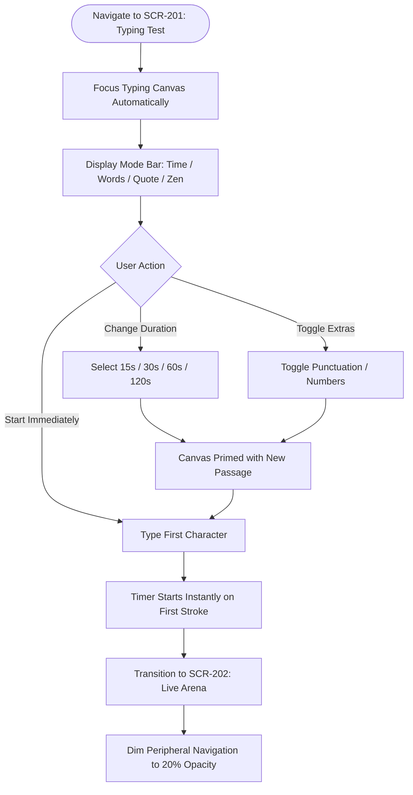

- **Key Decision Points:** Timer **must not start** on page load; it starts strictly upon the first valid keypress.
- **Post-Condition:** Test status changes to `RUNNING`; peripheral UI softly dimmed.

---

## 5. Journey 4: Completing a Typing Test

- **Trigger:** Timer hits `0:00` or the final word of the passage is typed.
- **User Goal:** Experience clean, non-jarring session termination and instant score computation.

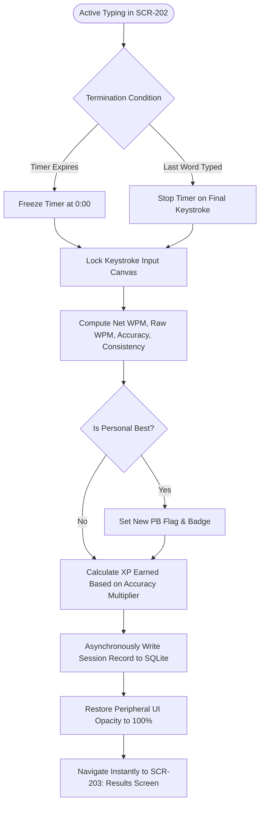

- **Key Decision Points:** Input lock prevents stray keystrokes from skewing accuracy after timer expires.
- **Post-Condition:** Session persisted to local SQLite; results rendered in $< 16\text{ ms}$.

---

## 6. Journey 5: Reviewing Test Results

- **Trigger:** User lands on `SCR-203` after completing a test.
- **User Goal:** Understand performance, inspect missed keys, and take the next recommended action.

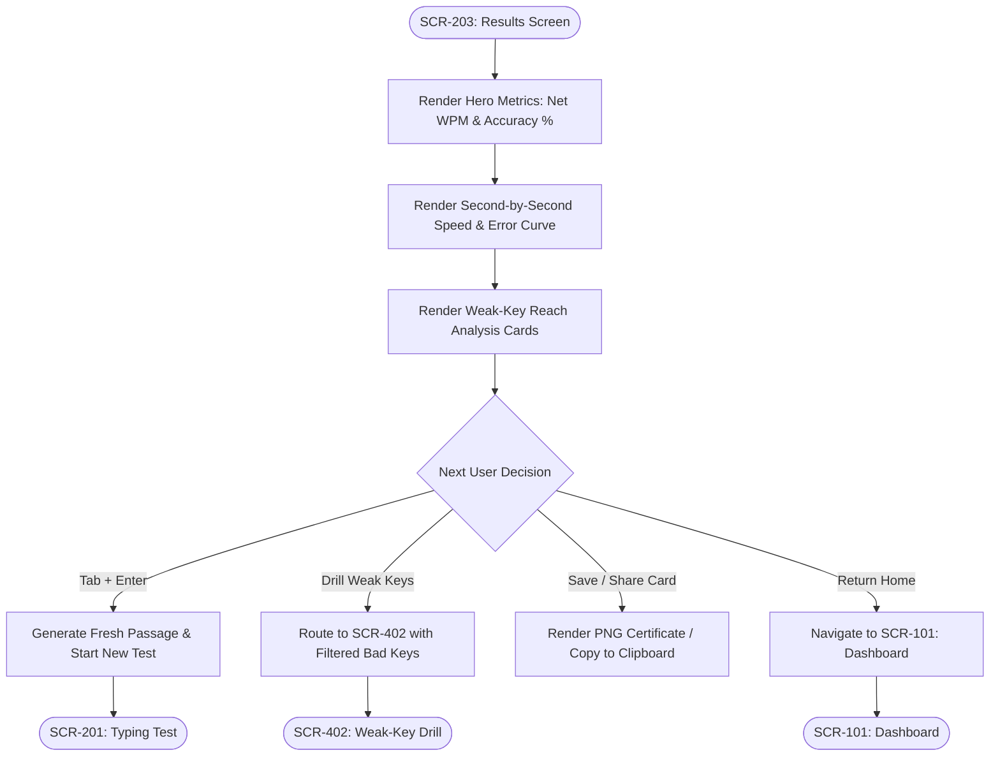

- **Key Decision Points:** `Tab + Enter` shortcut prominent for power typists who want continuous drills.
- **Post-Condition:** User either loops back into a fresh test or transitions to targeted practice.

---

## 7. Journey 6: Starting a Learning Lesson

- **Trigger:** User selects "Learning Mode" (`Ctrl + 3`) from the sidebar.
- **User Goal:** Advance through the structured touch-typing curriculum step-by-step.

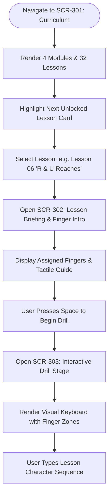

- **Key Decision Points:** Lessons enforce linear progression; future modules remain locked until prerequisite module mastery test is passed.
- **Post-Condition:** Lesson active state initialized; visual keyboard finger guide locked to target keys.

---

## 8. Journey 7: Practising Weak Keys

- **Trigger:** User clicks "Drill Weak Keys" from Results (`SCR-203`) or selects "Weak-Key Remediation" in Skill Drills (`SCR-402`).
- **User Goal:** Eliminate muscle memory friction on high-error characters.

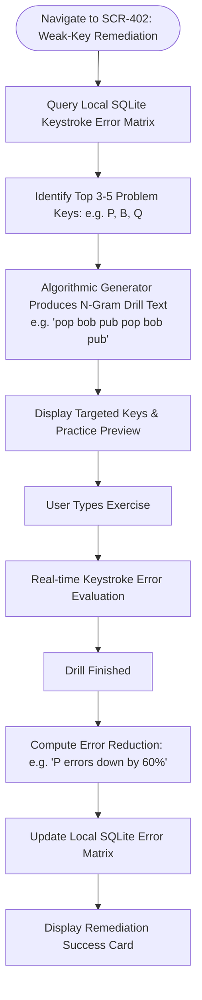

- **Key Decision Points:** Dynamic drill text generation is 100% deterministic, running purely client-side without internet.
- **Post-Condition:** User's keystroke error matrix updated; error severity on target keys reduced.

---

## 9. Journey 8: Playing a Typing Game

- **Trigger:** User selects "Typing Games" (`Ctrl + 5`) from sidebar.
- **User Goal:** Test burst speed, reactive reflexes, and peripheral word reading in a gaming format.

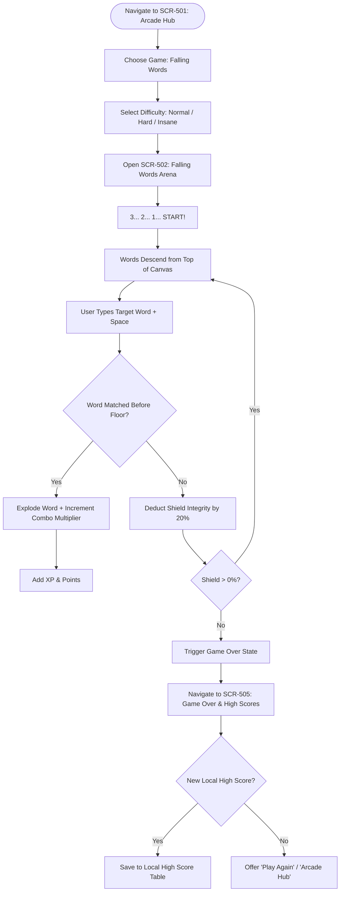

- **Key Decision Points:** Games reward combo accuracy; frantically typing wrong words breaks combos and incurs penalty.
- **Post-Condition:** Game score saved to local leaderboards; arcade XP awarded.

---

## 10. Journey 9: Practising Programming Syntax

- **Trigger:** User selects "Developer Mode" (`Ctrl + 6`) from sidebar.
- **User Goal:** Build muscle memory for programming language tokens, brackets, indentation, and symbols.

```mermaid
flowchart TD
    EnterDev([Navigate to SCR-601: Developer Hub]) --> SelectLang[Select Language: TypeScript]
    SelectLang --> SelectSnippetLevel[Select: Standard Idiomatic Snippets]
    SelectSnippetLevel --> OpenStage[Open SCR-602: Code Syntax Stage]
    
    OpenStage --> RenderCode[Render Monospace Code Block with Syntax Colors]
    RenderCode --> SetCaret[Place Caret at Line 1, Column 1]
    
    SetCaret --> UserTypesCode[User Types Code Token: e.g. 'interface User {']
    UserTypesCode --> CheckEnter{User Hits Enter on Line End?}
    
    CheckEnter -- Yes --> AutoIndent[Auto-Advance Indentation to Next Line Depth]
    CheckEnter -- No --> AdvanceCol[Advance Column by 1]
    
    AutoIndent --> NextToken[Wait for Next Character]
    AdvanceCol --> NextToken
    
    NextToken --> FinishBlock[Code Block Fully Typed]
    FinishBlock --> CalcDevStats[Compute Symbol Accuracy & Syntax WPM]
    CalcDevStats --> ShowDevSummary[Display Dev Mode Performance Card]
```

- **Key Decision Points:** Indentation auto-advance: Users should not have to manually press spacebar 4 times for indentation; the engine auto-aligns indentation when `Enter` is struck, matching real IDE ergonomics.
- **Post-Condition:** Developer typing telemetry logged; symbol accuracy profile updated.

---

## 11. Journey 10: Reviewing Typing Analytics

- **Trigger:** User selects "Analytics" (`Ctrl + 7`) from sidebar.
- **User Goal:** Inspect historical progression, identify plateau causes, and review the keyboard error heatmap.

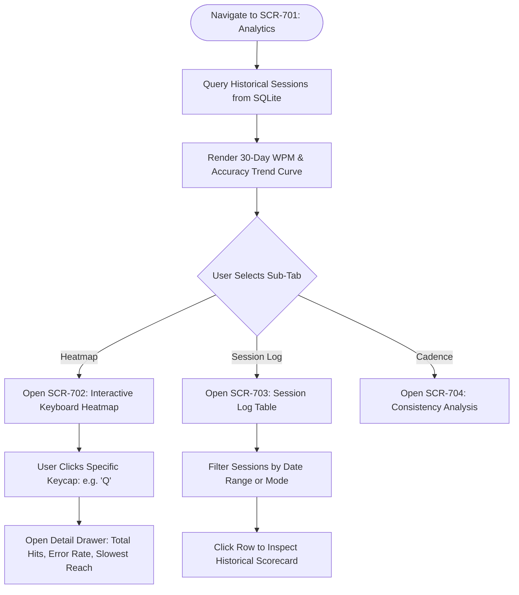

- **Key Decision Points:** Heatmap clearly distinguishes between *slow keys* (latency) and *missed keys* (accuracy).
- **Post-Condition:** User gains diagnostic insight into typing habits.

---

## 12. Journey 11: Unlocking Achievements

- **Trigger:** User achieves a milestone (e.g., completes 100th test or breaks 100 WPM with $\ge 98\%$ accuracy).
- **User Goal:** Receive gratifying, non-disruptive feedback and inspect unlocked badge in the trophy cabinet.

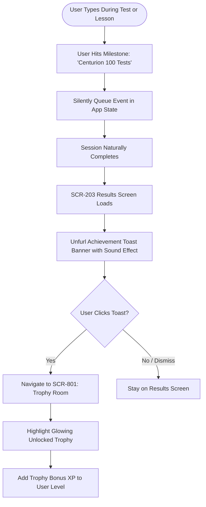

- **Key Decision Points:** Achievement alerts are strictly **queued** and unfurled after session completion to avoid breaking flow.
- **Post-Condition:** Achievement marked `UNLOCKED` in SQLite; bonus XP credited.

---

## 13. Journey 12: Changing Settings and Themes

- **Trigger:** User clicks "Settings" (`Ctrl + 9`) or uses shortcut `Ctrl + Shift + T` / `Ctrl + Shift + M`.
- **User Goal:** Personalize themes, caret styling, sound effects, and verify local data backup.

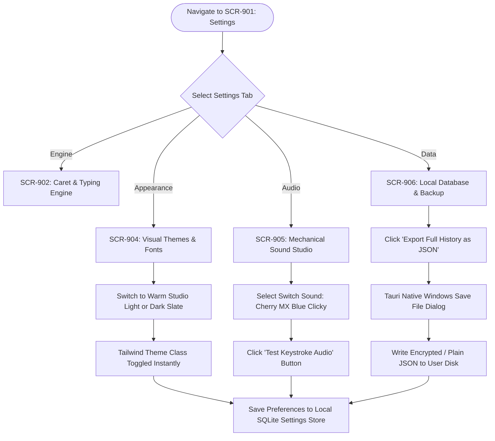

- **Key Decision Points:** Theme transitions occur instantly without requiring an application reload.
- **Post-Condition:** Local preference table updated; all desktop views immediately reflect new styling.
