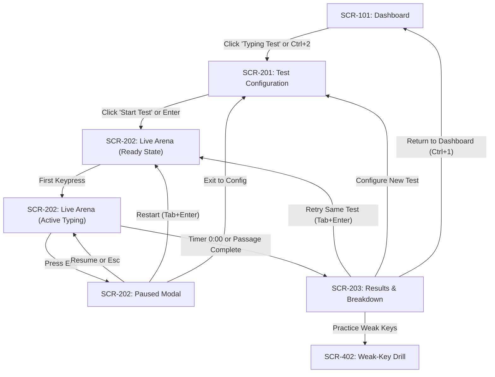

# TYPING TEST ARENA — UX SPECIFICATION (D4)
**Typing Trainer — Windows Desktop Application**
*Screen IDs: SCR-201 (Configuration), SCR-202 (Live Arena), SCR-203 (Results & Performance)*
*Target Resolution: 1440 × 900 (Responsive: 1280 × 720 to 2560 × 1440)*
*Document Version: 1.0.0 | Stage: D4 Typing Test Arena Design*
*Date: 2026-11-17 | Status: D4 DESIGN COMPLETE (AWAITING PRODUCT OWNER REVIEW)*

---

## 1. Executive Summary & Module Mission

The **Typing Test Arena** is the core interactive centerpiece of the **Typing Trainer** desktop application. While the Dashboard (`SCR-101`) anchors the user's daily habit and progression, the Typing Test Arena is where deliberate practice, skill acquisition, and official benchmark evaluation occur.

The module encompasses three interconnected, sequential screens forming a frictionless end-to-end journey:
1. **SCR-201: Typing Test Configuration & Setup:** A focused, uncluttered configuration stage where typists select duration, corpus type, difficulty tier, and linguistic parameters before launching.
2. **SCR-202: Live Typing Test Arena:** A high-performance, distraction-minimized typing canvas featuring real-time character evaluation, fluid smooth-scrolling text, an unobtrusive performance HUD, and an optional pastel mechanical keyboard visualizer.
3. **SCR-203: Test Results & Performance Breakdown:** An honest, celebratory performance scorecard providing second-by-second speed telemetry, error diagnostics, deterministic practice recommendations, and validated XP rewards.

```
+---------------------------------------------------------------------------------------+
|                              END-TO-END USER JOURNEY                                  |
+----------------------+     +----------------------+     +-----------------------------+
|       SCR-201        |     |       SCR-202        |     |           SCR-203           |
|  Test Configuration  | --> |   Live Typing Test   | --> |   Results & Performance     |
| (Duration, Text,     |     | (Active Typing,      |     | (Net WPM, Accuracy, Curve,  |
|  Difficulty, Toggles)|     |  Caret, HUD, Keys)   |     |  Weak Keys, XP & Retry)     |
+----------------------+     +----------------------+     +-----------------------------+
          ^                                                              |
          |----------------------- Retake / Reconfigure -----------------|
```

---

## 2. Design Governance & Project Alignment

All D4 deliverables strictly comply with the established architectural and design system rules:

| Design Dimension | Approved Governance Standard | Application in D4 Typing Test Arena |
|---|---|---|
| **Platform Model** | Windows Desktop (Tauri 2 + Rust + React) | Local-first, offline execution; zero cloud calls during active typing. |
| **Visual Direction** | Direction D: Gaming-Inspired Learning | Professional desktop precision balanced with luminous status accents. |
| **Theme System** | Dual Theme: Midnight Slate (Dark) & Daylight Studio (Light) | Fully validated in both themes with complete token parity. |
| **Primary Action Color** | `#2563EB` (Cobalt Blue) with `#FFFFFF` text | **5.17:1** contrast ratio (verified WCAG AA compliant). |
| **Typography** | `Inter` (UI/Controls) + `JetBrains Mono` (Typing Text/HUD) | Strict separation between interface chrome and monospace typing canvas. |
| **Layout Rhythm** | 4px Grid Spacing Token System | Centered stage with max-width `1100px`, 24px gutters, zero horizontal jitter. |
| **Keyboard Visual** | 65% ANSI Pastel Mechanical Gaming Keyboard | DSA uniform profile keycaps, PBT material aesthetic, homing bumps on F & J. |
| **Data Privacy** | 100% Local-First & Single-User | No remote telemetry, no external population percentiles, no LLM integration. |
| **Keystroke Loop** | Pure Frontend Loop (React / Zustand) | Keystrokes evaluated in-memory at 0 ms latency; Spring Boot only receives completed session payloads. |

---

## 3. Core UX Principles for the Typing Arena

### 3.1 Distraction-Minimized Focus
During active typing (`SCR-202`), peripheral application chrome (navigation sidebar, window titlebar, status bar) is automatically softened to **20% opacity** through smooth CSS opacity transitions. The user's foveal and parafoveal vision remains dedicated entirely to upcoming text characters and the active caret.

### 3.2 Instantaneous Visual Feedback (Zero-Latency Guarantee)
Every keypress produces an instantaneous optical response within $< 8\text{ ms}$:
- **Correct Character:** Turns electric cyan/emerald with subtle brightness confirmation.
- **Incorrect Character:** Turns vibrant coral red with a crisp underline indicator.
- **Caret Flow:** Smooth 50ms transform physics glide between monospace character glyphs without stutter.

### 3.3 Honest & Deterministic Telemetry
Typing Trainer avoids artificial gamification or deceptive vanity metrics:
- Metrics use standardized 5-character word definitions and subtract uncorrected errors.
- Recommendations on `SCR-203` are calculated through local error matrices, never fabricated by AI models.
- Fictitious percentile rankings ("Top 10% in the world") are prohibited; all performance comparisons relate strictly to the user's authentic local personal records and documented benchmarks.

### 3.4 Keyboard-First Fluidity
A touch-typing application must never force the user to lift their hands to use the mouse:
- Seamless progression: `SCR-201` (`Enter` to start) $\rightarrow$ `SCR-202` (Immediate active typing) $\rightarrow$ `SCR-203` (`Enter` on focused Retry button or `Ctrl + 1` to return to Dashboard).
- Unintended global shortcut traps are eliminated: `Space` and `Enter` only activate focused interactive controls outside the typing canvas. During active typing, `Space` is strictly a word delimiter.
- Dedicated accelerators: `F5` / `Ctrl + R` for quick restart, `F8` / `Ctrl + Shift + H` for Zen Mode, `Esc` for pause.

---

## 4. Architectural Information Hierarchy

```
+-------------------------------------------------------------------------------+
| TITLEBAR: Windows Chrome • [⌨] Typing Trainer • Offline-Ready [●] • [Ctrl+K]  |
+-------------------+-----------------------------------------------------------+
| SIDEBAR (240px)   | MAIN WORKSPACE STAGE (Max-width: 1100px Centered)         |
|                   |                                                           |
| OVERVIEW          | [SCR-201: CONFIGURATION VIEW]                             |
|   [📊] Dashboard  | - Header: Mode Title & Estimated Duration                 |
| PRACTICE          | - Duration Selector Pills (15s, 30s, 60s, 120s, Custom)   |
|   [⚡] Test       | - Corpus Source Tabs (Random, Common, Sentences, Dev, Cust)|
|        (ACTIVE)   | - Difficulty Tier Pills (Beginner, Inter, Adv, Expert)    |
|   [🎓] Learning   | - Modifier Toggles (Punctuation, Numbers, Capitalization) |
|   [🎯] Drills     | - Selected Parameters Summary Pill                        |
|   [💻] Developer  | - Primary CTA: [ Start Typing Test (Enter) → ]            |
|   [🎮] Games      |                                                           |
| MASTERY           | [SCR-202: LIVE ARENA VIEW - AUTO-TRANSITION]              |
|   [📈] Analytics  | - Top Live HUD: [Time 0:42] [68 WPM] [98.2% Acc] [0 Err]  |
|   [🏆] Trophies   | - Distraction-Free Text Stream (3-Line Monospace Window)  |
|   [⚙] Settings    | - Active Caret with Smooth Fluid Motion                   |
|                   | - Pastel Mechanical Keyboard Visualizer (Collapsible)     |
| [●] Lvl 12 Typist | - Quick Controls: [Esc] Pause | [F5] Restart | [F8] Zen   |
| 🔥 5 Day Streak   |                                                           |
|                   | [SCR-203: RESULTS VIEW - POST-TEST SUMMARY]               |
|                   | - Hero Scorecard: 72 WPM Net • 98.4% Acc • NEW PB Badge   |
|                   | - Speed Progression & Cadence Curve (Recharts)            |
|                   | - Diagnostic Error Breakdown & Weak-Key Remediation Card  |
|                   | - XP Awarded (+110 XP) & Daily Goal Contribution          |
|                   | - Actions: [ Retry Same (Enter) ] [ Practice Weak Keys ]  |
+-------------------+-----------------------------------------------------------+
| STATUS BAR: [F5] Quick Restart | [Esc] Pause | Latency: 0ms                   |
+-------------------------------------------------------------------------------+
```

---

## 5. Screen Transitions & State Routing



---

## 6. Color Token Reference for Typing States

| Semantic State | Dark Theme (Midnight Slate) | Light Theme (Daylight Studio) | Contrast vs Canvas |
|---|---|---|---|
| **Canvas Background** | `#0B0F19` | `#F8FAFC` | — |
| **Card / Text Container** | `#131B2E` | `#FFFFFF` | — |
| **Correct Character** | `#38BDF8` (Sky Blue) / `#10B981` (Emerald) | `#0284C7` (Cobalt) / `#059669` (Forest) | $\ge 6.5:1$ (AA Pass) |
| **Incorrect Character** | `#EF4444` (Coral Red) | `#DC2626` (Crimson Red) | $\ge 4.6:1$ (AA Pass) |
| **Pending Character** | `#64748B` (Muted Slate) | `#94A3B8` (Soft Slate) | $\ge 3.5:1$ (Large text) |
| **Active Caret** | `#2563EB` (Electric Cobalt) | `#2563EB` (Cobalt Blue) | $\ge 5.1:1$ (AA Pass) |
| **Active Key Highlight** | `#3B82F6` glow with `#2563EB` fill | `#2563EB` fill with `#FFFFFF` text | $\ge 5.1:1$ (AA Pass) |
| **Primary Action Button** | `#2563EB` with `#FFFFFF` text | `#2563EB` with `#FFFFFF` text | **5.17:1** (Verified) |

---

## 7. Figma Master Deliverables Cross-Reference

In compliance with the Starter Plan page architecture:
- **Figma File:** `https://www.figma.com/design/LvHRp11TZikdxNFeZvapO0`
- **Target Page:** Page 3: `🖥 03. Desktop Flows & Screen Templates`
- **Master Nodes:**
  - `Node 2:2`: `02. Screen — Live Typing Test Arena (1440x900)` (`SCR-202`)
  - `Node 4:2`: `03. Screen — Typing Test Results & Performance (1440x900)` (`SCR-203`)
  - Configuration flow integrated into Page 3 flow layout as `SCR-201` master frame.
