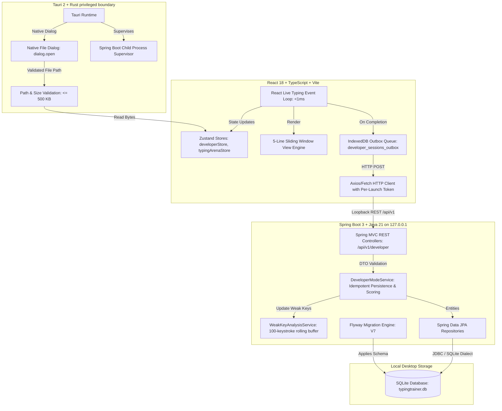

# Phase D7: Developer Mode (The Code Studio)
# Deliverable 7: Engineering Handoff Readiness & Implementation Checklist

## 1. Executive Summary & Purpose

This document serves as the comprehensive engineering handoff specification for **Phase D7: Developer Mode (The Code Studio)**. It translates the approved UX architecture, design system specifications, and mathematical formulas into an actionable technical blueprint for the implementation team (Claude Code).

All architectural boundaries, state models, event loops, persistence lifecycles, database schemas, and testing requirements are formally specified to ensure strict adherence to `AGENTS.md`, `ARCHITECTURE.md`, `SECURITY.md`, and `API_CONTRACT.md`.

---

## 2. System Architecture & Component Responsibilities



### 2.1 Architectural Invariants
1. **Local-First & Offline:** Backend binds only to `127.0.0.1`. No external network calls.
2. **Keystroke Processing Isolation:** Live keystroke events run exclusively in React memory; no HTTP requests per keystroke.
3. **Privileged Operations via Rust:** Custom file selection is gated through Tauri native file dialogs with path canonicalization and size validation ($\le 500\text{ KB}$).
4. **Idempotent Persistence:** Completed sessions generate a client UUID stored in IndexedDB before submission to backend REST endpoints.

---

## 3. Frontend Architecture & Zustand State Models

### 3.1 Zustand Store Architecture
State is cleanly partitioned across three dedicated stores to prevent excessive re-renders:

#### 1. `developerCatalogStore` (`src/stores/developerCatalogStore.ts`)
- Manages catalog browsing, language filters, and snippet metadata:
  ```typescript
  interface DeveloperCatalogState {
    selectedLanguage: LanguageId;
    selectedTier: number; // 1 to 4
    catalogSnippets: DeveloperSnippetSummaryDTO[];
    isLoading: boolean;
    error: string | null;
    setSelectedLanguage: (lang: LanguageId) => void;
    fetchCatalog: () => Promise<void>;
  }
  ```

#### 2. `typingArenaStore` (`src/stores/typingArenaStore.ts`)
- High-frequency live typing state localized strictly to `SCR-603`:
  ```typescript
  interface TypingArenaState {
    exerciseId: string;
    sessionUuid: string;
    targetLines: CodeLine[]; // Normalized \n tokens with syntax classes
    activeLineIndex: number;
    activeCharIndex: number;
    userInputs: string[]; // Typed characters for active line
    attemptedCharsCount: number;
    correctCharsCount: number;
    incorrectCharsCount: number;
    backspaceCount: number;
    correctedMistakesCount: number;
    uncorrectedErrorsCount: number;
    isPaused: boolean;
    isCompleted: boolean;
    activeStartTime: number | null;
    elapsedSeconds: number;
    // Configuration
    autoIndentMode: 'smart' | 'manual';
    autoCloseBrackets: boolean;
    // Actions
    handleKeyDown: (e: KeyboardEvent) => void;
    pauseSession: () => void;
    resumeSession: () => void;
    resetSession: () => void;
  }
  ```

#### 3. `customFileImporterStore` (`src/stores/customFileImporterStore.ts`)
- Manages file ingestion, Option A pagination, and part progress:
  ```typescript
  interface CustomFileImporterState {
    currentFile: CustomFileMetadata | null;
    parts: ExercisePartSummary[];
    activePartIndex: number;
    ingestionError: string | null;
    importFile: (filePath: string) => Promise<void>;
    selectPart: (partIndex: number) => void;
  }
  ```

---

## 4. IndexedDB Outbox & Persistence Lifecycle

To guarantee data integrity across application restarts or transient backend delays, session submission executes the following resilient pipeline:

```mermaid
sequenceDiagram
    participant React as React Typing Arena
    participant IDB as IndexedDB Outbox
    participant Client as REST Client
    participant Spring as Spring Boot API
    participant SQLite as SQLite DB

    React->>React: Session Finishes (Line N complete)
    React->>React: Generate Client UUID (RFC 4122 v4)
    React->>IDB: Write Session to developer_sessions_outbox (status: PENDING)
    React->>Client: Trigger Background Sync
    Client->>Spring: POST /api/v1/developer/sessions (with Session UUID)
    
    alt Successful First Submission (HTTP 201 Created)
        Spring->>SQLite: Insert session & syntax records
        Spring-->>Client: HTTP 201 Created { sessionId, status: PERSISTED }
        Client->>IDB: Delete entry from Outbox
        Client->>React: Update UI: Status = Persisted (Green)
    else Duplicate Submission (HTTP 200 OK)
        Spring->>Spring: Detect existing UUID + identical payload
        Spring-->>Client: HTTP 200 OK { sessionId, status: DUPLICATE_ACKNOWLEDGED }
        Client->>IDB: Delete entry from Outbox
        Client->>React: Update UI: Status = Persisted (Green)
    else Conflicting Payload (HTTP 409 Conflict)
        Spring-->>Client: HTTP 409 Conflict { error: PAYLOAD_MISMATCH }
        Client->>IDB: Mark entry as QUARANTINED
        Client->>React: Update UI: Status = Conflict Detected (Amber)
    else Backend Unavailable (Network / Timeout)
        Client-->>IDB: Increment retry_count; leave as PENDING
        Client->>React: Update UI: Status = Saved Locally (Offline)
    end
```

---

## 5. Local REST API Contract

All endpoints reside under `/api/v1/developer` and enforce Jakarta Bean Validation:

| HTTP Verb | Path | Request Body | Response DTO | Purpose |
|---|---|---|---|---|
| `GET` | `/api/v1/developer/languages` | None | `List<LanguageSummaryDTO>` | Returns approved language catalog with user mastery levels. |
| `GET` | `/api/v1/developer/exercises` | Params: `lang`, `tier` | `List<DeveloperExerciseSummaryDTO>` | Retrieves curated catalog snippets for selected language. |
| `GET` | `/api/v1/developer/exercises/{id}` | None | `DeveloperExerciseDetailDTO` | Retrieves full snippet text, syntax tokens, and metadata. |
| `POST` | `/api/v1/developer/sessions` | `SubmitDeveloperSessionRequest` | `DeveloperSessionResponseDTO` | Idempotent session submission. Updates D6 rolling buffer. |
| `POST` | `/api/v1/developer/custom-files`| `ImportCustomFileRequest` | `CustomFileSummaryDTO` | Ingests custom code, applies Option A pagination. |
| `GET` | `/api/v1/developer/custom-files/{id}/parts` | None | `List<ExercisePartSummaryDTO>` | Retrieves paginated parts and completion statuses. |

### DTO Schema: `SubmitDeveloperSessionRequest`
```java
public record SubmitDeveloperSessionRequest(
    @NotNull UUID sessionUuid,
    @NotBlank String exerciseId,
    @NotBlank String languageId,
    @Min(0) double grossWpm,
    @Min(0) double netWpm,
    @DecimalMin("0.0") @DecimalMax("100.0") double overallAccuracy,
    @DecimalMin("0.0") @DecimalMax("100.0") double symbolAccuracy,
    @Min(0) long activeDurationMillis,
    @Min(0) int totalAttemptedInputs,
    @Min(0) int correctInputs,
    @Min(0) int incorrectInputs,
    @Min(0) int backspaceCount,
    @Min(0) int correctedMistakes,
    @Min(0) int uncorrectedErrors,
    @NotNull List<SyntaxCategoryMetricDTO> syntaxMetrics,
    @NotNull String contentPayloadHash
) {}
```

---

## 6. Flyway Database Schema: `V7__create_developer_mode_schema.sql`

```sql
-- Flyway Database Migration: V7__create_developer_mode_schema.sql
-- Module: D7 Developer Mode (The Code Studio)

CREATE TABLE developer_languages (
    language_id VARCHAR(32) PRIMARY KEY,
    display_name VARCHAR(64) NOT NULL,
    syntax_grammar VARCHAR(32) NOT NULL,
    icon_asset_id VARCHAR(64) NOT NULL,
    sort_order INTEGER NOT NULL DEFAULT 0,
    is_active BOOLEAN NOT NULL DEFAULT TRUE
);

CREATE TABLE developer_exercises (
    exercise_id VARCHAR(64) PRIMARY KEY,
    language_id VARCHAR(32) NOT NULL REFERENCES developer_languages(language_id),
    title VARCHAR(128) NOT NULL,
    description TEXT,
    difficulty_tier INTEGER NOT NULL CHECK (difficulty_tier BETWEEN 1 AND 4),
    target_code TEXT NOT NULL,
    normalized_line_count INTEGER NOT NULL,
    syntax_token_count INTEGER NOT NULL,
    symbol_density_score REAL NOT NULL DEFAULT 0.0,
    created_at TIMESTAMP NOT NULL DEFAULT CURRENT_TIMESTAMP
);

CREATE TABLE developer_sessions (
    session_uuid VARCHAR(36) PRIMARY KEY,
    exercise_id VARCHAR(64) REFERENCES developer_exercises(exercise_id),
    custom_part_id VARCHAR(64),
    language_id VARCHAR(32) NOT NULL REFERENCES developer_languages(language_id),
    gross_wpm REAL NOT NULL,
    net_wpm REAL NOT NULL,
    overall_accuracy REAL NOT NULL,
    symbol_accuracy REAL NOT NULL,
    active_duration_millis INTEGER NOT NULL,
    attempted_inputs INTEGER NOT NULL,
    correct_inputs INTEGER NOT NULL,
    incorrect_inputs INTEGER NOT NULL,
    backspace_count INTEGER NOT NULL,
    corrected_mistakes INTEGER NOT NULL,
    uncorrected_errors INTEGER NOT NULL,
    content_payload_hash VARCHAR(64) NOT NULL,
    created_at TIMESTAMP NOT NULL DEFAULT CURRENT_TIMESTAMP
);

CREATE TABLE developer_syntax_analytics (
    analytics_id VARCHAR(36) PRIMARY KEY,
    session_uuid VARCHAR(36) NOT NULL REFERENCES developer_sessions(session_uuid) ON DELETE CASCADE,
    category_id VARCHAR(32) NOT NULL CHECK (category_id IN ('DELIMITER', 'OPERATOR', 'PUNCTUATION', 'IDENTIFIER', 'KEYWORD')),
    total_opportunities INTEGER NOT NULL,
    correct_keystrokes INTEGER NOT NULL,
    error_keystrokes INTEGER NOT NULL,
    accuracy_percentage REAL NOT NULL,
    burst_wpm REAL NOT NULL DEFAULT 0.0
);

CREATE TABLE custom_code_files (
    file_id VARCHAR(36) PRIMARY KEY,
    file_name VARCHAR(255) NOT NULL,
    language_id VARCHAR(32) NOT NULL REFERENCES developer_languages(language_id),
    raw_bytes BLOB NOT NULL,
    content_hash VARCHAR(64) NOT NULL UNIQUE,
    file_size_bytes INTEGER NOT NULL CHECK (file_size_bytes <= 512000),
    total_lines INTEGER NOT NULL,
    total_parts INTEGER NOT NULL,
    created_at TIMESTAMP NOT NULL DEFAULT CURRENT_TIMESTAMP
);

CREATE TABLE custom_code_file_parts (
    part_id VARCHAR(64) PRIMARY KEY,
    file_id VARCHAR(36) NOT NULL REFERENCES custom_code_files(file_id) ON DELETE CASCADE,
    part_number INTEGER NOT NULL,
    start_line INTEGER NOT NULL,
    end_line INTEGER NOT NULL,
    line_count INTEGER NOT NULL CHECK (line_count <= 20),
    target_code TEXT NOT NULL,
    is_completed BOOLEAN NOT NULL DEFAULT FALSE,
    best_net_wpm REAL DEFAULT 0.0,
    best_accuracy REAL DEFAULT 0.0,
    UNIQUE (file_id, part_number)
);

CREATE INDEX idx_dev_sessions_lang ON developer_sessions(language_id);
CREATE INDEX idx_dev_sessions_created ON developer_sessions(created_at);
CREATE INDEX idx_dev_analytics_session ON developer_syntax_analytics(session_uuid);
CREATE INDEX idx_custom_parts_file ON custom_code_file_parts(file_id);
```

---

## 7. Test Strategy & Engineering Verification Plan

### 7.1 Frontend Unit Tests (Vitest + React Testing Library)
1. **Typing Calculation Engine (`src/utils/typingCalculations.test.ts`):**
   - Verify all 8 worked examples from `D7_CALCULATION_VERIFICATION_REPORT.md`.
   - Test dynamic uncorrected error penalty at $t = 30\text{s}$, $60\text{s}$, $68\text{s}$, $120\text{s}$.
   - Test zero Net WPM penalty for backspaced mistakes.
   - Test zero division guard when $N_{total} == 0$.
2. **5-Line Window Viewport (`src/components/developer/CodeStage.test.tsx`):**
   - Test vertical translation trigger when reaching line boundary.
   - Verify line $k-1$ renders with 50% opacity and line $k$ with 100% opacity.
   - Verify instant snapping when `@media (prefers-reduced-motion: reduce)` is simulated.
3. **Keyboard Trapping & Guarded Restart (`src/hooks/useDeveloperShortcuts.test.ts`):**
   - Simulate `F5` / `Ctrl+R` when $t = 5\text{s}$ (instant reset).
   - Simulate `F5` / `Ctrl+R` when $t = 15\text{s}$ (modal displayed, timer paused).
   - Simulate `Tab` key (verify `e.preventDefault()` called).

### 7.2 Backend Tests (JUnit 5 + Mockito + MockMvc)
1. **Controller & Validation (`DeveloperSessionControllerTest.java`):**
   - Test valid submission returns `HTTP 201 Created`.
   - Test duplicate submission with matching UUID and hash returns `HTTP 200 OK`.
   - Test duplicate submission with mismatching hash returns `HTTP 409 Conflict`.
   - Test Bean Validation constraints (negative WPM, duration $<0$).
2. **D6 Closed-Loop Bridge (`WeakKeyAnalysisServiceTest.java`):**
   - Verify symbol error rates from `developer_sessions` update the D6 100-keystroke rolling buffer.
3. **Flyway Migration (`FlywayMigrationTest.java`):**
   - Execute `V7` migration on clean SQLite instance; verify constraints and indexes.

### 7.3 End-to-End Tests (Playwright)
1. **Curated Exercise Full Flow:**
   - Navigate from Hub (`SCR-601`) $\rightarrow$ Setup (`SCR-602`) $\rightarrow$ Arena (`SCR-603`) $\rightarrow$ Complete typing $\rightarrow$ Scorecard (`SCR-605`).
   - Click D6 Remediation CTA; verify navigation to `/drills/weak-key?symbol={token}`.
2. **Custom Code Ingestion Flow:**
   - Ingest a 65-line Java file.
   - Verify Option A creates balanced parts of $\le 20$ lines (e.g. 4 parts of 16–17 lines).
   - Complete Part 1; verify Part 1 is marked completed and Part 2 unlocks.

---

## 8. Engineering Risk Matrix & Mitigations

| Risk ID | Risk Description | Likelihood | Impact | Architectural Mitigation |
|---|---|---|---|---|
| **RSK-01** | `F5`/`Ctrl+R` webview reload wipes session. | High | Critical | Trap at window event level + Tauri webview config; implement Guarded Restart modal. |
| **RSK-02** | Keystroke lag during high-frequency bursts ($>120\text{ WPM}$). | Low | High | Pure React in-memory event loop; zero DOM layout reflow; zero REST I/O on keypress. |
| **RSK-03** | Auto-indentation inflates user WPM. | High | Medium | Enforce D7-OD-05 Smart Auto-Advance: synthetic spaces do not increment $N_{total}$. |
| **RSK-04** | Large custom file causes memory spike. | Low | High | Strict 500 KB limit enforced in Rust before file read; reject larger files immediately. |
| **RSK-05** | SQLite write lock contention on rapid submissions. | Low | Medium | IndexedDB outbox queues submissions; Spring Boot service uses bounded retries. |

---

## 9. Handoff Readiness Sign-Off

- **Technical Completeness:** 100% of data models, state stores, REST contracts, database migrations, and testing plans are fully specified.
- **Architectural Boundary Adherence:** Strict compliance with `AGENTS.md` and `SECURITY.md`.
- **Handoff Status:** **APPROVED FOR STAGE 5 (CLAUDE CODE IMPLEMENTATION)**.
