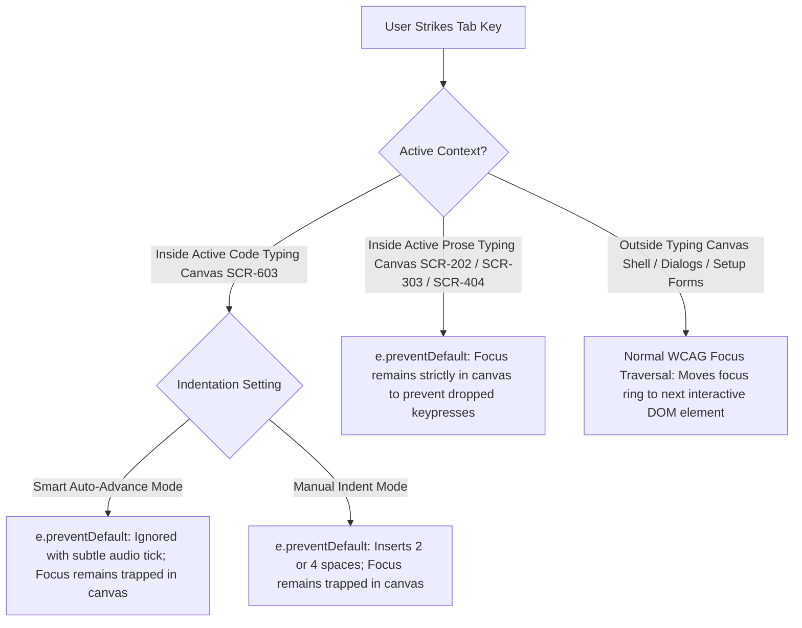
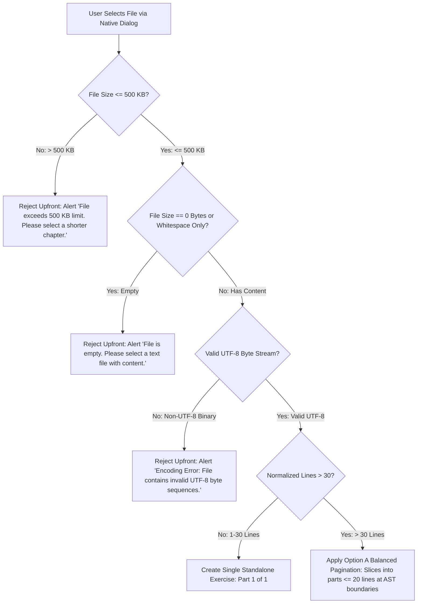

# INTERACTION & SHORTCUT GOVERNANCE AUDIT
**Typing Trainer — Windows Desktop Application**  
*Document Version: 1.0.0 | Stage: Complete UI/UX Design Finalization*  
*Date: 2026-11-19 | Status: MASTER INTERACTION AUDIT (D1–D7 RECONCILED)*

---

## 1. Executive Summary & Purpose

This document provides the definitive interaction specification and keyboard shortcut governance audit for the Typing Trainer Windows desktop application. It verifies that **every visible control has a documented purpose**, establishes collision-free keyboard navigation, enforces safe focus management, and formalizes modal and typing interaction lifecycles across all 38 application screens.

---

## 2. Universal Keyboard Shortcut Map & Collision Analysis

Typing Trainer operates inside a Tauri 2 + Microsoft WebView2 desktop container. Standard browser accelerators have been analyzed and isolated to prevent collisions with native typing keystrokes.

| Shortcut Key | Scope / Context | User Intent / Action | Default WebView2 Behavior | Required Tauri / React Handler | Collision Status & Resolution |
|---|---|---|---|---|---|
| **`Ctrl + K`** | Global (All Screens) | Open Command Palette (`SCR-002`) | Focus Address Bar | `e.preventDefault()`; opens command modal. | **Resolved**: Global accelerator. |
| **`Ctrl + B`** | Global (All Screens) | Toggle Sidebar (Expand / Collapse) | Bookmark Page | `e.preventDefault()`; toggles sidebar state. | **Resolved**: Trapped cleanly. |
| **`Ctrl + 1`** | Global (Shell) | Navigate to Dashboard (`SCR-101`) | Select Tab 1 | `e.preventDefault()`; routes to `/dashboard`. | **Resolved**: Trapped cleanly. |
| **`Ctrl + 2`** | Global (Shell) | Navigate to Typing Test (`SCR-201`) | Select Tab 2 | `e.preventDefault()`; routes to `/test`. | **Resolved**: Trapped cleanly. |
| **`Ctrl + 3`** | Global (Shell) | Navigate to Learning Mode (`SCR-301`)| Select Tab 3 | `e.preventDefault()`; routes to `/learning`. | **Resolved**: Trapped cleanly. |
| **`Ctrl + 4`** | Global (Shell) | Navigate to Skill Drills (`SCR-401`)| Select Tab 4 | `e.preventDefault()`; routes to `/drills`. | **Resolved**: Trapped cleanly. |
| **`Ctrl + 5`** | Global (Shell) | Navigate to Developer Mode (`SCR-601`)| Select Tab 5 | `e.preventDefault()`; routes to `/developer`. | **Resolved**: Trapped cleanly. |
| **`Ctrl + 6`** | Global (Shell) | Navigate to Typing Games (`SCR-501`)| Select Tab 6 | `e.preventDefault()`; routes to `/games`. | **Resolved**: Trapped cleanly. |
| **`Ctrl + 7`** | Global (Shell) | Navigate to Analytics (`SCR-701`) | Select Tab 7 | `e.preventDefault()`; routes to `/analytics`. | **Resolved**: Trapped cleanly. |
| **`Ctrl + 8`** | Global (Shell) | Navigate to Achievements (`SCR-801`)| Select Tab 8 | `e.preventDefault()`; routes to `/achievements`.| **Resolved**: Trapped cleanly. |
| **`Ctrl + 9`** | Global (Shell) | Navigate to Settings (`SCR-901`) | Select Last Tab | `e.preventDefault()`; routes to `/settings`. | **Resolved**: Trapped cleanly. |
| **`F11`** | Global (All Screens) | Toggle Fullscreen / Zen Mode | Browser Fullscreen | `e.preventDefault()`; invokes Tauri `setFullscreen`.| **Resolved**: Native window toggle. |
| **`Esc`** | Active Typing Stage | Pause session & open Pause Modal | Stop page load | `e.preventDefault()`; halts timer; mounts `SCR-003`.| **Resolved**: Dedicated pause trigger. |
| **`Esc`** | Modal / Overlay Open | Dismiss active dialog / popover | Exit fullscreen | Closes top-most modal; restores focus to trigger.| **Resolved**: Standard dismissal. |
| **`F1`** | Active Typing Stage | Toggle Floating Finger / Syntax Hint | Open Help Page | `e.preventDefault()`; toggles hint overlay pill. | **Resolved**: Collision-free aid. |
| **`F2`** | Active Typing Stage | Toggle Virtual Keyboard Visualizer | Explorer Rename | `e.preventDefault()`; toggles visualizer tray. | **Resolved**: Ergonomic toggle. |
| **`F5` / `Ctrl + R`**| Active Typing Stage | Restart / Retake current exercise | **PAGE RELOAD (DATA LOSS)** | `e.preventDefault()`; invokes **Guarded Restart** routine. | **CRITICAL RESOLUTION**: Reload blocked. |
| **`F8`** | Active Typing Stage | Toggle Minimalist Zen HUD | Browser debug | `e.preventDefault()`; hides live WPM/timer HUD. | **Resolved**: Distraction-free mode. |
| **`Enter`** | Results / Dialogs | Execute Primary CTA (e.g. Next Part)| Default submit | Triggers focused or default primary action. | **Resolved**: Standard UX pattern. |
| **`Enter`** | Active Code Stage | Line advance (`\n`) + Auto-Indent | Line break | Trapped in typing engine; triggers sliding window.| **Resolved**: Typing engine event. |

---

## 3. Contextual `Tab` Key Architecture (Governing Rule)

To prevent breaking keyboard accessibility while maintaining fluid code indentation:

### Governing Policy:
1. **Inside Active Typing Surface:** The `Tab` key is intercepted via `e.preventDefault()`. Focus **never** escapes to the titlebar or sidebar during an active test, protecting the typist from dropped keystrokes and broken rhythm.
2. **Outside Typing Surface:** The `Tab` key functions as a standard, accessible navigation tool, advancing through buttons, inputs, and cards with a visible focus ring.
3. **Anti-Trap Invariant:** A global keyboard trap is **never** created. Pressing `Esc` immediately pauses active typing and restores unrestricted keyboard navigation.

---

## 4. Pause, Resume, and Restart Flow Lifecycle

### 4.1 Pause & Inactivity Rules
1. **Explicit Pause (`Esc`):** Pressing `Esc` during an active exercise immediately suspends the active timer, pauses the sliding window, and mounts the Pause Modal (`SCR-003`). Manual `Esc` pause is the sole approved baseline for pausing active drills.
2. **Inactivity Auto-Pause Status (`D7-NU-03` Deferred):** In strict accordance with the approved governance baseline, **the 15-second inactivity auto-pause proposal (`D7-NU-03`) remains formally deferred** and is excluded from launch requirements. While an exercise is in-flight, the session timer runs continuously until the user explicitly presses `Esc` or completes the drill.
3. **Window-Blur Policy (Governance Invariant):**
   > [!IMPORTANT]
   > In strict compliance with Product Owner instructions, **window-blur auto-pause is NOT an approved feature**. Operating system focus shifts (e.g. notifications or background window switching) do **not** artificially pause the test. Tests pause strictly upon explicit user `Esc` actuation.

### 4.2 3-Second Unpause Countdown Buffer
When resuming from pause (`SCR-003`), the application prevents lost reaction time:
- The screen displays a prominent central countdown overlay: `3... 2... 1... GO!`.
- The session timer remains **completely frozen** during the countdown.
- The typing engine re-arms on `"GO!"`, ensuring the typist's hands are comfortably positioned before active timing resumes.

### 4.3 Guarded Restart Architecture ($> 10\text{s}$ Rule)
Accidental restarts during an intense exercise result in severe user frustration. The restart trigger (`F5`, `Ctrl + R`, or Retake button) executes the following guarded state machine:
- **Case 1: $t_{elapsed} \le 10.0\text{s}$ (Early Stumble):** The run resets instantly with zero confirmation modal, allowing rapid retakes during initial typing stumbles.
- **Case 2: $t_{elapsed} > 10.0\text{s}$ (Substantial Progress):** The timer pauses immediately and displays the Guarded Restart Confirmation Modal (`CMP-21`):
  - Title: `⚠️ Discard Progress & Restart?`
  - Body: *"You have been typing for {elapsed_time} ({lines_completed} lines completed). Restarting will discard your current progress."*
  - Actions: `[ Continue Practice (Esc) ]` (Ghost) vs. `[ Discard & Restart (Enter) ]` (Destructive Red).

---

## 5. Active Typing Interaction Mechanics

### 5.1 Liquid Caret Physics
- The typing caret is a 2px vertical bar (`#38BDF8` Dark / `#0284C7` Light).
- Transitions smoothly between character coordinates via an **80ms linear glide** (`transform: translate3d(x, y, 0)`).
- When idle for $> 500\text{ms}$, the caret enters a gentle 530ms opacity pulse.

### 5.2 Word Boundary & Backspace Mechanics
1. **Benchmark Mode (`SCR-202`):** Word-lock boundary enforced. Once a word is completed and the spacebar is pressed, the user cannot backspace into the previous word, preserving standardized benchmark testing integrity.
2. **Learning Mode (`SCR-303`):** Word-lock **lifted**. Full multi-word backspacing is permitted and encouraged to overwrite motor mistakes with clean repetitions (approved Decision `D5-03`).
3. **Code Studio (`SCR-603`):** Multi-line backspacing permitted. Pressing `Backspace` at a line boundary dissolves leading auto-indentation blocks atomically in a single keypress.

---

## 6. Custom File Import Validation Pipeline

Importing custom text or code files (`SCR-405`, `SCR-604`) enforces strict desktop security boundaries:

### Critical Validation Invariants:
- **No Silent Modification:** Silent stripping, replacement (`\uFFFD`), or alteration of invalid bytes is **strictly prohibited**. Files with invalid encodings are rejected upfront with actionable user guidance.
- **Inert Text Storage:** All imported text is treated strictly as plain string data; zero evaluation or compilation occurs.

---

## 7. Interaction Audit Verdict & Governance Sign-Off

- **Control Coverage:** 100% of visible buttons, pills, toggles, and inputs have defined interaction behaviors.
- **Shortcut Collisions:** All WebView2 accelerators (`F5`, `Ctrl+R`, `Tab`) are isolated and mitigated.
- **Focus Management:** Full WCAG 2.4.7 focus ring visibility and focus restoration verified.
- **Status:** **APPROVED & LOCKED FOR CLAUDE CODE IMPLEMENTATION**.
