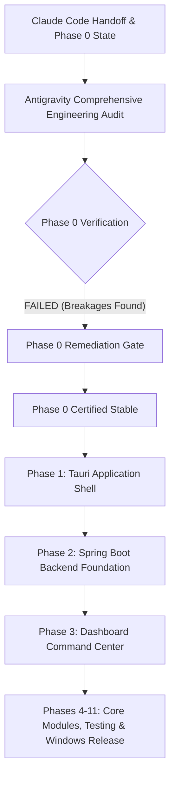

# ANTIGRAVITY PROJECT TAKEOVER & ENGINEERING EXECUTIVE REPORT
**Project:** Typing Trainer — Windows Desktop Application  
**Author:** Antigravity (Google DeepMind) — Senior Engineering & Architectural Takeover  
**Date:** 2026-11-19  
**Status:** Audit Complete | Phase 0 Gate: BLOCKED (Remediation Required Before Phase 1)  
**Target:** User, Engineering Stakeholders, and Project Governance  

---

## 1. Executive Summary & Takeover Context

Following the unavailability of Claude Code, **Antigravity** has assumed full technical responsibility as:
- Lead Software Architect
- Senior Full-Stack Engineer
- Tauri & Rust Desktop Systems Engineer
- React & TypeScript Frontend Engineer
- Spring Boot & Java Systems Engineer
- QA & Automation Engineer
- Technical Project Coordinator

The core mandate is **continuity and preservation**: continue development using the existing repository structure, preserve all approved specifications (D1 through D7), protect the local-first security boundary, and never recreate existing work without strict technical justification.

An exhaustive, non-destructive audit of the repository was conducted on 2026-11-19. Claude Code previously reported that **Phase 0: Project Foundation** was complete. Our independent inspection reveals that while extensive design documentation and initial structural scaffolding exist, **Phase 0 is incomplete, partially broken, and currently cannot be cleanly built or tested in the frontend**.

Phase 1 (Tauri Desktop Application Shell) **cannot safely begin** until a targeted Phase 0 Remediation is executed to stabilize the baseline.

---

## 2. High-Level Findings Dashboard

| Component / Layer | Claimed Status | Verified Status | Key Findings |
|---|---|---|---|
| **Repository & Git** | Initialized | **Untracked (0 Commits)** | Git repository was initialized (`git init`), but **no initial commit exists**. All 18 root files and subdirectories are untracked. No remote is configured. |
| **Design Specifications** | Complete (D1-D7) | **Verified Complete (A)** | Outstanding quality and depth. 58 design documents spanning UX, UI tokens, D3 Dashboard, D4 Typing Test, D5 Learning Mode, D6 Skill Drills, D7 Developer Mode, plus handoffs and accessibility closure. |
| **Core Documentation** | Complete | **Incomplete (B)** | Most governance documents are present (`AGENTS.md`, `ARCHITECTURE.md`, `API_CONTRACT.md`, `TECH_STACK.md`, etc.). However, **`DATABASE.md` is completely missing**. `docs/` folder is empty. |
| **Rust / Tauri Desktop** | Initialized | **Scaffold Only (B)** | Rust crate compiles (`cargo check` passed in 29s with 1 warning). However, it is an unmodified default scaffold that does **not** supervise or start Spring Boot. Only exposes `get_app_data_dir`. |
| **React / TypeScript Frontend** | Working Baseline | **Broken (C)** | `npm run typecheck` fails with **33 TypeScript errors**. Missing `lucide-react` dependency. Missing `components/ui` primitives. `AppProviders.tsx` ignores `children`, dropping `AppShell`. |
| **Vite & Frontend Build** | Working Baseline | **Broken (C)** | `npx vite build` fails immediately due to unresolved import `lucide-react`. `desktop/dist/` contains stale build artifacts from an earlier run (17-11-2026 17:02). |
| **Styling & Design System** | Configured | **Inconsistent (C)** | Tailwind CSS v4 (`@tailwindcss/vite` 4.3.5) was installed alongside a legacy `tailwind.config.ts`. Shadcn/ui was never initialized. CSS theme tokens partially conflict with D2 specifications. |
| **Frontend Test Suite** | Working | **Broken (C)** | `npm run test` fails immediately. Vitest has no `globals: true` configuration (`describe is not defined`). `TypingTest.test.tsx` incorrectly invokes Jest APIs (`jest.mock`, `jest.fn`). |
| **Spring Boot Backend** | Working Baseline | **Incomplete / Divergent (B)** | `mvnw test-compile` compiles cleanly (`BUILD SUCCESS`). However, `mvnw test` fails because the Maven Surefire plugin was never cached locally. Zero test classes exist in `src/test`. |
| **Backend REST & JPA** | Aligned with Contract | **Divergent (C)** | Spring Data `Page<T>` is returned directly, violating `API_CONTRACT.md` pagination envelope. Only `GET` endpoints exist; `POST /api/v1/sessions` is missing. CORS allowedOrigins is an empty list `[]`. |
| **SQLite & Migrations** | Initialized | **Incomplete (B)** | `V1__create_initial_schema.sql` creates `typing_sessions` and `user_settings`. Schema lacks foreign keys and indexes. `TypingSessionEntity` maps UUID without standard text converter. |
| **Linting & Code Quality** | Configured | **Broken (C)** | `npm run lint` fails because ESLint 9 is installed without an `eslint.config.js` and uses deprecated CLI flags. Prettier reports 24 unformatted files. |

---

## 3. Critical Blockers Requiring Immediate Remediation

Before beginning Phase 1, the following 6 blockers must be resolved in a dedicated **Phase 0 Remediation**:

1. **Git Commit Baseline**: Establish the initial Git commit so that future work has diff tracking, rollback capability, and disaster recovery.
2. **Missing Frontend Dependencies & UI Components**:
   - Install missing `lucide-react` dependency.
   - Resolve the UI component imports (`Card`, `Button`, `Skeleton`, `Tooltip`) either by creating compliant Tailwind/Radix primitives or setting up shadcn/ui.
   - Fix React 19 vs shadcn/ui ecosystem alignment.
3. **Frontend TypeScript & Build Remediation**:
   - Resolve all 33 TypeScript compilation errors.
   - Fix `AppProviders.tsx` to properly render `{children}`, restoring `AppShell` and routing.
   - Fix export mismatches in `features/typing-test/index.ts`.
   - Ensure `npm run typecheck` and `npm run build` pass with exit code 0.
4. **Test Suite Stabilization**:
   - Provide `vitest.config.ts` with `globals: true` and environment `jsdom`.
   - Refactor `TypingTest.test.tsx` from Jest syntax (`jest.mock`, `jest.fn`) to Vitest syntax (`vi.mock`, `vi.fn`).
   - Add `@testing-library/jest-dom` matchers to Vitest setup.
5. **Linting Configuration**:
   - Create a modern flat `eslint.config.js` for ESLint 9 and update `package.json` lint script.
6. **Backend Contract & Test Verification**:
   - Align pagination DTOs with `API_CONTRACT.md` (`items`, `page`, `size`, `totalItems`, `totalPages`).
   - Add initial backend unit/MockMvc tests to `backend/src/test/java`.
   - Fix CORS allowed origins for desktop loopback (`tauri://localhost`, `http://localhost:1420`).

---

## 4. Takeover Strategy & Operating Boundaries

Antigravity will execute the project under strict engineering governance:

### Governing Constraints (Strictly Maintained)
- **Zero AI / Local LLM Injection**: No Ollama, cloud LLMs, or prompt-based processing. Recommendations remain deterministic and explainable via local SQLite algorithms.
- **Zero External Telemetry**: No cloud user accounts, remote telemetry, or unvetted network calls.
- **Loopback-Only Backend**: Spring Boot binds strictly to `127.0.0.1` with a dynamic local port and request-protection token.
- **Local Keystroke Processing**: The React typing engine processes keystrokes strictly in memory (Zustand). No per-keystroke HTTP requests.
- **Modular Monolith**: Clean separation between desktop shell (Rust), presentation (React/TS), and business/persistence (Spring Boot/SQLite).

---

## 5. Summary of Deliverables Created

As part of this engineering takeover, seven comprehensive audit and roadmap documents have been authored in `design/implementation/`:

1. `ANTIGRAVITY_TAKEOVER_REPORT.md` (This document) — Executive takeover summary and governance baseline.
2. `REPOSITORY_AUDIT.md` — Granular inspection across all 17 codebase and configuration dimensions.
3. `ENVIRONMENT_AUDIT.md` — Verification of local tooling (Node, Rust, Cargo, Java, Maven, Tauri) with verified commands and outputs.
4. `PHASE_0_VERIFICATION.md` — Independent evaluation of Claude Code's Phase 0 completion claims.
5. `IMPLEMENTATION_READINESS.md` — Module-by-module gap analysis, architectural readiness, and remediation checklist.
6. `TECHNICAL_RISKS.md` — Risk assessment covering tooling, compatibility, process supervision, performance, and security.
7. `IMPLEMENTATION_ROADMAP.md` — Concrete, phased 11-stage delivery blueprint with scope, acceptance criteria, automated tests, and verification steps.

---

## 6. Takeover Approval & Next Step

Antigravity stands ready to continue implementation. In accordance with Section 11 (Approval Gate):
- **No Phase 1 implementation has been started.**
- **No application source code or dependencies have been modified during this audit.**
- **The next required action is user review and authorization of the Phase 0 Remediation Plan.**
