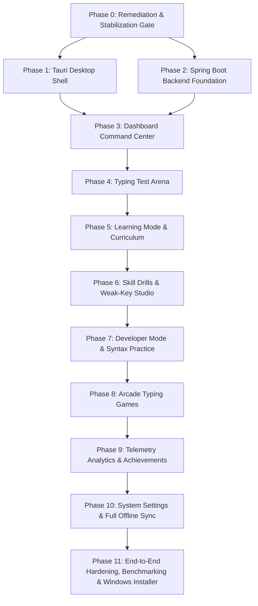

# MASTER IMPLEMENTATION ROADMAP
**Project:** Typing Trainer — Windows Desktop Application  
**Author:** Antigravity (Google DeepMind) — Lead Software Architecture  
**Date:** 2026-11-19  
**Execution Target:** Phased Delivery from Remediation to Production Windows Release  

---

## 1. Roadmap Overview & Dependency Flow

---

## 2. Phase-by-Phase Execution Blueprints

---

### Phase 0: Project Stabilization & Remediation Gate (Prerequisite)
- **Goal:** Resolve all 6 critical Phase 0 blockers, establish Git commit history, and stabilize frontend/backend build and test pipelines so development can proceed safely.
- **Dependencies:** None (Immediate action).
- **Files Expected to Change / Be Created:**
  - `git commit` baseline
  - `desktop/package.json` (add `lucide-react`)
  - `desktop/src/components/ui/` (`button.tsx`, `card.tsx`, `skeleton.tsx`, `tooltip.tsx`)
  - `desktop/src/components/layout/` (`AppShell.tsx`, `Titlebar.tsx`, `Sidebar.tsx`, `ErrorBoundary.tsx`)
  - `desktop/src/app/providers/AppProviders.tsx` (wire `{children}` and `<Outlet />`)
  - `desktop/src/features/typing-test/index.ts` (fix named vs default exports)
  - `desktop/vitest.config.ts` (create Vitest configuration with `globals: true`)
  - `desktop/src/features/typing-test/__tests__/TypingTest.test.tsx` (migrate to Vitest syntax)
  - `desktop/eslint.config.js` (create ESLint 9 configuration)
  - `backend/src/main/java/com/typingtrainer/config/CorsConfig.java` (fix allowed origins)
  - `docs/DATABASE.md` (create database schema documentation)
- **Acceptance Criteria:**
  1. Git repository has initial baseline commit.
  2. `npm run typecheck` exits with 0 errors.
  3. `npm run build` succeeds, generating valid `dist/` bundle.
  4. `npm run test` executes and passes 100% of test suites.
  5. `npm run lint` executes cleanly without CLI syntax errors.
  6. Backend `mvnw test-compile` continues to succeed cleanly.
- **Automated Tests:**
  - Frontend: `vitest run` on `index.test.ts` and `TypingTest.test.tsx`.
- **Manual Verification:**
  - Launch `npm run dev` and confirm in browser that AppShell renders titlebar and sidebar.
- **Completion Report Requirement:**
  - Deliver `design/implementation/PHASE_0_REMEDIATION_REPORT.md` with verified command outputs.

---

### Phase 1: Tauri Desktop Application Shell
- **Goal:** Implement the privileged native desktop container, custom Windows frameless window, Tauri IPC layer, and Spring Boot child process supervisor with Windows Job Objects.
- **Dependencies:** Phase 0 Remediation.
- **Scope:**
  - Custom frameless titlebar with native Windows minimize, maximize/restore, and close controls via Tauri window APIs.
  - Rust child process manager that starts Spring Boot (`java -jar` or packaged runtime), captures the assigned port, and terminates it gracefully on exit.
  - Windows Job Object attachment to prevent zombie processes.
  - Tauri command `get_backend_connection_details()` returning dynamic port and security token.
  - System tray icon and window state persistence (size, position, maximized state).
- **Files Expected to Change:**
  - `desktop/src-tauri/Cargo.toml` (add `winapi` or `windows-sys` for job objects)
  - `desktop/src-tauri/src/lib.rs` (process supervision and window commands)
  - `desktop/src-tauri/src/process_manager.rs` (new process supervisor)
  - `desktop/src-tauri/tauri.conf.json` (window configuration, decorations: false)
  - `desktop/src/components/layout/Titlebar.tsx` (bind to Tauri window APIs)
  - `desktop/src/services/tauriService.ts` (frontend IPC wrappers)
- **Acceptance Criteria:**
  1. Desktop window launches as a frameless, native-styled Windows window.
  2. Titlebar minimize, maximize, and close buttons operate window correctly.
  3. Tauri launches Spring Boot child process; logs appear in application log directory.
  4. Closing Tauri immediately terminates the Java child process (verified via PowerShell `Get-Process`).
- **Automated Tests:**
  - Rust unit tests in `src-tauri/src/process_manager.rs`.
  - Frontend tests mocking `@tauri-apps/api/window`.
- **Manual Verification:**
  - Launch desktop via `npm run tauri:dev`. Inspect Task Manager to verify parent/child relationship and termination.
- **Completion Report Requirement:**
  - Deliver `design/implementation/PHASE_1_COMPLETION_REPORT.md`.

---

### Phase 2: Spring Boot Backend Foundation
- **Goal:** Build the complete REST API baseline, SQLite persistence engine, Flyway migrations (`V1`–`V2`), security token filter, and request validation layer.
- **Dependencies:** Phase 0 Remediation.
- **Scope:**
  - Dynamic port binding (`server.port=0`) with port reporting to stdout/file.
  - Security token filter (`RequestTokenFilter`) validating `X-Request-Token`.
  - Align REST responses with `API_CONTRACT.md`:
    - `PagedResponse<T>` (`items`, `page`, `size`, `totalItems`, `totalPages`).
    - Standard `ApiErrorResponse`.
  - Flyway migration `V2__add_session_indexes_and_stats.sql` adding indexes on `completed_at` and `gross_wpm`.
  - Implement session submission: `POST /api/v1/sessions` with Jakarta Bean Validation (`@Valid`).
  - Unit and MockMvc test suite covering controllers, services, and repositories.
- **Files Expected to Change:**
  - `backend/src/main/resources/application.yml`
  - `backend/src/main/resources/db/migration/V2__add_session_indexes_and_stats.sql`
  - `backend/src/main/java/com/typingtrainer/security/RequestTokenFilter.java`
  - `backend/src/main/java/com/typingtrainer/common/response/PagedResponse.java`
  - `backend/src/main/java/com/typingtrainer/typing/dto/TypingSessionSubmissionRequest.java`
  - `backend/src/main/java/com/typingtrainer/typing/controller/TypingSessionController.java`
  - `backend/src/main/java/com/typingtrainer/typing/service/TypingSessionService.java`
  - `backend/src/test/java/com/typingtrainer/typing/TypingSessionControllerTest.java`
  - `backend/src/test/java/com/typingtrainer/typing/TypingSessionServiceTest.java`
- **Acceptance Criteria:**
  1. `POST /api/v1/sessions` validates and persists sessions idempotently.
  2. `GET /api/v1/sessions` returns pagination envelope matching `API_CONTRACT.md`.
  3. Requests lacking valid `X-Request-Token` are rejected with HTTP 401.
  4. All MockMvc tests pass with 100% success.
- **Automated Tests:**
  - `mvnw test` runs unit and MockMvc integration tests.
- **Manual Verification:**
  - Execute curl/powershell requests to `/internal/health` and `/api/v1/sessions` with and without tokens.
- **Completion Report Requirement:**
  - Deliver `design/implementation/PHASE_2_COMPLETION_REPORT.md`.

---

### Phase 3: Dashboard Command Center
- **Goal:** Implement the primary landing interface (SCR-101) according to D3 specifications and live node `15:2`.
- **Dependencies:** Phase 1 (AppShell), Phase 2 (Backend Sessions API).
- **Scope:**
  - Metric cards: Current WPM, Accuracy, Streak count, Total practice time.
  - Daily progress ring and weekly volume goal tracker.
  - Recent activity session feed with trend indicators.
  - Quick action launch buttons (15s, 30s, 60s, custom text).
  - High score and weak key badges preview.
  - Empty, loading (skeleton), and error states.
- **Files Expected to Change:**
  - `desktop/src/features/dashboard/Dashboard.tsx`
  - `desktop/src/features/dashboard/components/MetricCard.tsx`
  - `desktop/src/features/dashboard/components/ProgressRing.tsx`
  - `desktop/src/features/dashboard/components/RecentSessionsList.tsx`
  - `desktop/src/features/dashboard/components/QuickStartSelector.tsx`
  - `desktop/src/stores/useDashboardStore.ts`
  - `desktop/src/services/api/dashboardService.ts`
- **Acceptance Criteria:**
  1. Dashboard displays real user metrics loaded from `/api/v1/sessions`.
  2. Skeleton loading state displays while data is fetching.
  3. Empty state displays encouraging CTA when no sessions exist.
  4. Quick action buttons navigate cleanly to `/test/active?duration=15` etc.
- **Automated Tests:**
  - Component tests for `MetricCard`, `ProgressRing`, and `RecentSessionsList`.
  - Dashboard route integration test with mocked API client.
- **Manual Verification:**
  - Navigate to `/` in Midnight Slate and Daylight Studio themes; verify contrast and responsive layout (1200px down to 800px).
- **Completion Report Requirement:**
  - Deliver `design/implementation/PHASE_3_COMPLETION_REPORT.md`.

---

### Phase 4: Typing Test Arena
- **Goal:** Implement the flagship live typing engine, liquid caret, HUD telemetry, virtual mechanical keyboard, and post-test results screen (SCR-201, SCR-202, SCR-203) matching D4 specifications.
- **Dependencies:** Phase 2 (Session Submission), Phase 3 (Dashboard Navigation).
- **Scope:**
  - High-frequency in-memory typing loop (`useTypingStore`) processing keystrokes with sub-5ms latency.
  - 3-line rolling text stream with smooth vertical scrolling and visual character validation (correct, incorrect, extra).
  - Smooth liquid caret with customizable animation styles.
  - Live HUD: Real-time WPM, Accuracy %, countdown timer, and progress bar (throttled to 60fps/100ms).
  - Virtual 65% mechanical keyboard showing active target key and finger placement zone.
  - Results screen (SCR-203): Net WPM, Gross WPM, Accuracy, Error breakdown, and interactive Recharts speed/error timeline.
  - Local session persistence to backend with IndexedDB outbox fallback.
- **Files Expected to Change:**
  - `desktop/src/stores/useTypingStore.ts`
  - `desktop/src/features/test/TypingArena.tsx`
  - `desktop/src/features/test/components/TypingStream.tsx`
  - `desktop/src/features/test/components/LiquidCaret.tsx`
  - `desktop/src/features/test/components/TypingHUD.tsx`
  - `desktop/src/features/test/components/VirtualKeyboard.tsx`
  - `desktop/src/features/test/ResultsScreen.tsx`
  - `desktop/src/services/typingEngine/metricsCalculator.ts`
- **Acceptance Criteria:**
  1. WPM and accuracy calculations match mathematical formulas in `TYPING_CALCULATION_SPECIFICATION.md`.
  2. Keystroke input handles rapid typing (>150 WPM) without dropped characters or input lag.
  3. Backspace behaves correctly according to configuration (allow error backspacing vs locked).
  4. Upon timer expiry, session auto-submits to `/api/v1/sessions` and transitions to Results screen.
- **Automated Tests:**
  - Deterministic unit tests for `metricsCalculator.ts` (WPM, Net WPM, Accuracy edge cases).
  - Vitest component tests for `TypingArena`, `VirtualKeyboard`, and `ResultsScreen`.
- **Manual Verification:**
  - Complete full 15s, 30s, and 60s typing tests. Inspect live graphs and verify results in database.
- **Completion Report Requirement:**
  - Deliver `design/implementation/PHASE_4_COMPLETION_REPORT.md`.

---

### Phase 5: Learning Mode & Touch-Typing Curriculum
- **Goal:** Build the guided pedagogical curriculum, anatomical hand guidance, and module mastery assessments (SCR-301 through SCR-304) matching D5 specifications.
- **Dependencies:** Phase 4 (Typing Arena & Keyboard Components).
- **Scope:**
  - Curriculum roadmap view (SCR-301) showing progressive tier unlocking (Home Row, Top Row, Bottom Row, Numbers, Symbols).
  - Anatomical hand guide component showing reach trajectories from rest keys to target keys.
  - Lesson briefing screen (SCR-302) with key introduction and finger assignment animations.
  - Interactive drill stage (SCR-303) enforcing strict touch-typing accuracy thresholds (>=98%).
  - Module mastery assessment (SCR-304) with pass/retry scoring.
  - Backend curriculum and lesson progress tables (`Flyway V3`).
- **Files Expected to Change:**
  - `backend/src/main/resources/db/migration/V3__create_curriculum_schema.sql`
  - `backend/src/main/java/com/typingtrainer/learning/...`
  - `desktop/src/features/learning/...`
  - `desktop/src/components/hand-guide/HandGuideRig.tsx`
  - `desktop/src/stores/useLearningStore.ts`
- **Acceptance Criteria:**
  1. Lessons unlock progressively based on deterministic mastery thresholds.
  2. Hand guide accurately highlights corresponding left/right finger for every key.
  3. Progress is saved locally in SQLite and persists across application restarts.
- **Automated Tests:**
  - Pedagogical threshold calculation unit tests.
  - Curriculum unlocking logic tests.
- **Manual Verification:**
  - Step through Home Row lessons 1 through 5; verify unlocking and visual reach guidance.
- **Completion Report Requirement:**
  - Deliver `design/implementation/PHASE_5_COMPLETION_REPORT.md`.

---

### Phase 6: Skill Drills & Weak-Key Studio
- **Goal:** Implement the targeted weakness detection engine, N-gram drills, and custom drill creator (SCR-401 through SCR-405) matching D6 specifications.
- **Dependencies:** Phase 4 (Typing Arena), Phase 5 (Curriculum).
- **Scope:**
  - Statistical analysis of error frequencies per character and n-gram pairs (e.g. `th`, `ion`, `str`).
  - Weak-Key & Stat Inspector (SCR-402) rendering heatmap of problematic keys and error response times.
  - Dynamic drill generator creating targeted practice sentences containing the user's high-error keys.
  - Speed burst and endurance drill configurations.
- **Files Expected to Change:**
  - `backend/src/main/resources/db/migration/V4__create_drills_schema.sql`
  - `backend/src/main/java/com/typingtrainer/drills/...`
  - `desktop/src/features/drills/...`
  - `desktop/src/services/recommendations/weakKeyDetector.ts`
- **Acceptance Criteria:**
  1. Weak key detector identifies top 5 error-prone keys from historical session data.
  2. Generated drills contain dense repetitions of detected weak characters.
  3. Mastery scorecard verifies whether error rates on targeted keys decreased.
- **Automated Tests:**
  - Unit tests for weak-key detection algorithms and drill text generation.
- **Manual Verification:**
  - Intentionally make errors on specific keys ('p', 'q', 'z'); verify drill recommendations reflect those keys.
- **Completion Report Requirement:**
  - Deliver `design/implementation/PHASE_6_COMPLETION_REPORT.md`.

---

### Phase 7: Developer Mode & Syntax Practice
- **Goal:** Implement the code typing arena, multi-language syntax support, and custom code snippet importer (SCR-601 through SCR-605) matching D7 specifications.
- **Dependencies:** Phase 4 (Typing Arena).
- **Scope:**
  - Language selection hub (SCR-601): JavaScript, TypeScript, Python, Java, Rust, Go, C++, HTML/CSS, SQL.
  - Specialized 5-line code typing stage preserving indentation, braces, brackets, and symbol navigation.
  - Syntax highlighting renderer (JetBrains Mono font, token-colored typing display).
  - Custom snippet importer (SCR-604) supporting drag-and-drop `.ts`, `.java`, `.py` source files.
  - Syntax analytics scorecard (SCR-605) tracking symbol error rates (`{}`, `()`, `=>`, `::`, `[]`).
- **Files Expected to Change:**
  - `backend/src/main/resources/db/migration/V5__create_developer_mode_schema.sql`
  - `desktop/src/features/developer/...`
  - `desktop/src/components/typing/CodeTypingStream.tsx`
  - `desktop/src/services/syntax/syntaxTokenizer.ts`
- **Acceptance Criteria:**
  1. Tab and indentation handled cleanly without shifting browser focus.
  2. Symbols and special programming tokens tracked accurately.
  3. Imported files sanitized safely (no executable script injection).
- **Automated Tests:**
  - Tokenizer and indentation processing unit tests.
  - Snippet sanitizer security tests.
- **Manual Verification:**
  - Type sample snippets across Python, Rust, and JavaScript; verify indentation and symbol handling.
- **Completion Report Requirement:**
  - Deliver `design/implementation/PHASE_7_COMPLETION_REPORT.md`.

---

### Phase 8: Arcade Typing Games
- **Goal:** Build the interactive, game-inspired typing modules (Falling Words Defense, Time Attack Sprint, Word Scramble) matching SCR-501 through SCR-505.
- **Dependencies:** Phase 4 (Typing Engine & Zustand stores).
- **Scope:**
  - Arcade Hub (SCR-501) with game selection and local high-score leaderboards.
  - Falling Words Defense (SCR-502): Dynamic canvas/SVG rendering with falling word obstacles destroyed by accurate typing.
  - Time Attack Sprint (SCR-503): Rapid-fire sudden death mode where errors deduct time.
  - Word Scramble Decryptor (SCR-504): Anagram typing puzzle.
  - Game Over & High Score scorecard (SCR-505) with arcade audio effects.
- **Files Expected to Change:**
  - `desktop/src/features/games/...`
  - `desktop/src/features/games/falling-words/FallingWordsGame.tsx`
  - `desktop/src/features/games/time-attack/TimeAttackGame.tsx`
  - `desktop/src/stores/useGameStore.ts`
- **Acceptance Criteria:**
  1. Games render at consistent 60fps without GC pause stutter.
  2. High scores save to local SQLite database.
  3. Pause menu (`Esc`) halts game loop immediately.
- **Automated Tests:**
  - Game loop state transitions and score calculation tests.
- **Manual Verification:**
  - Play each game mode through completion and game over; verify score recording.
- **Completion Report Requirement:**
  - Deliver `design/implementation/PHASE_8_COMPLETION_REPORT.md`.

---

### Phase 9: Telemetry Analytics & Achievements
- **Goal:** Implement the historical session explorer, keyboard heatmap, cadence analytics, and achievement trophy room (SCR-701 through SCR-803).
- **Dependencies:** Phase 2 (Backend Sessions), Phase 4 (Results).
- **Scope:**
  - Historical Session Explorer (SCR-703) with date filtering, pagination, and CSV export.
  - Keyboard Heatmap (SCR-702): Interactive 65% keyboard colored by key error rates and typing velocity.
  - Cadence Lab (SCR-704): Consistency percentage and inter-keystroke variance graphs via Recharts.
  - Achievement Engine (SCR-801, SCR-802, SCR-803): Badges, XP leveling ladder, daily streak tracker.
- **Files Expected to Change:**
  - `backend/src/main/resources/db/migration/V6__create_achievements_schema.sql`
  - `backend/src/main/java/com/typingtrainer/analytics/...`
  - `backend/src/main/java/com/typingtrainer/achievements/...`
  - `desktop/src/features/analytics/...`
  - `desktop/src/features/achievements/...`
- **Acceptance Criteria:**
  1. Heatmap accurately reflects historical character error rates.
  2. Achievements unlock deterministically based on verified SQLite statistics.
  3. CSV export produces RFC 4180-compliant files via native Windows save dialog.
- **Automated Tests:**
  - Achievement unlocking rule tests.
  - Analytics aggregation query tests.
- **Manual Verification:**
  - Inspect heatmaps and export session CSV; verify data integrity.
- **Completion Report Requirement:**
  - Deliver `design/implementation/PHASE_9_COMPLETION_REPORT.md`.

---

### Phase 10: System Settings & Full Offline Sync
- **Goal:** Implement user preferences, mechanical audio effects, theme customization, database backup/restore, and complete offline sync (SCR-901 through SCR-906).
- **Dependencies:** All previous functional modules.
- **Scope:**
  - General preferences: Default duration, caret style, auto-restart shortcuts.
  - Keyboard & hand guidance settings (layout selection: QWERTY, Dvorak, Colemak).
  - Appearance: Smooth switching between Midnight Slate and Daylight Studio themes.
  - Mechanical Audio Studio (SCR-905): Realistic synthesised/sampled mechanical switch audio (Blue clicky, Brown tactile, Red linear).
  - Database Management (SCR-906): Local database compaction, vacuuming, manual backup, and restore via native file dialogs.
- **Files Expected to Change:**
  - `desktop/src/features/settings/...`
  - `desktop/src/services/audio/mechanicalAudioEngine.ts`
  - `desktop/src/services/backup/backupService.ts`
  - `backend/src/main/java/com/typingtrainer/settings/...`
- **Acceptance Criteria:**
  1. Theme switches instantly without page reload.
  2. Mechanical key sound effects trigger on keydown with <10ms audio latency (Web Audio API).
  3. Database backup and restore validates file integrity before replacing SQLite file.
- **Automated Tests:**
  - Audio engine trigger tests.
  - Backup/restore validation tests.
- **Manual Verification:**
  - Test backup creation and restore on test database. Verify all user settings persist.
- **Completion Report Requirement:**
  - Deliver `design/implementation/PHASE_10_COMPLETION_REPORT.md`.

---

### Phase 11: Testing, Optimization & Windows Release Packaging
- **Goal:** Execute full Playwright end-to-end tests, accessibility audit verification, memory/startup performance benchmarking, and produce a production-ready Windows installer.
- **Dependencies:** Complete application (Phases 0 through 10).
- **Scope:**
  - End-to-end automated test suites in Playwright covering critical user journeys.
  - Automated WCAG 2.2 AA contrast and keyboard accessibility verification.
  - Startup time optimization (Tauri window ready in <1.5s, Spring Boot ready in <3.0s).
  - Package production Windows application (bundled Java runtime, Tauri binary, frontend assets, SQLite initial schema) into `.msi` / `.exe` installer.
  - Verify clean uninstallation and zero orphaned files or registry entries.
- **Files Expected to Change:**
  - `desktop/e2e/...` (Playwright test suites)
  - `scripts/windows/package.ps1`
  - `desktop/src-tauri/tauri.conf.json` (bundle configuration)
- **Acceptance Criteria:**
  1. 100% of Playwright E2E tests pass.
  2. Application launches, operates, and closes without error on a clean Windows machine without pre-installed Java.
  3. Zero network requests made outside `127.0.0.1` (verified via packet inspection / network proxy).
  4. Memory footprint under 250MB combined (Tauri webview + Spring Boot child process).
- **Automated Tests:**
  - Complete test battery: `vitest run`, `mvn test`, `playwright test`.
- **Manual Verification:**
  - Install application via installer on fresh Windows test machine, complete onboarding, typing test, and learning drill offline.
- **Completion Report Requirement:**
  - Deliver `design/implementation/PHASE_11_RELEASE_REPORT.md`.
