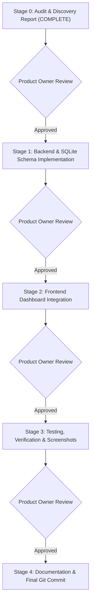

# PHASE 3 DISCOVERY REPORT: DASHBOARD INTEGRATION WITH REAL BACKEND DATA

**Project:** Typing Trainer  
**Document Version:** 1.0.0  
**Stage:** Stage 0 — Repository and Architecture Audit  
**Starting Baseline Commit:** `a2603b3`  
**Date:** November 19, 2026  
**Engineering Lead:** Antigravity  
**Product Owner:** User  

---

## 1. Executive Summary & Audit Baseline

In accordance with Product Owner Phase 3 authorization, this Stage 0 audit evaluates the current repository state, maps the 10 approved D3 Dashboard widgets directly to authoritative backend data models, identifies database schema and REST API additions, and establishes an engineering roadmap for implementation.

### 1.1 Git Status & Integrity Verification
- **Verified Current HEAD:** `a2603b3e8c8ef469d1de4c3012766c03dd9b997f` (`docs: add phase 2 final acceptance verification report`).
- **Working Tree:** Clean (0 untracked files, 0 uncommitted modifications).
- **Previous Phase Status:** Phase 2 formally closed and accepted.
- **Phase 3 Guard:** Strictly zero source code modifications have been made during Stage 0.

---

## 2. Current Architecture & Existing Foundations

### 2.1 Tauri & Desktop Boundary
- **Process Manager:** `desktop/src-tauri/src/backend/manager.rs` manages the packaged Spring Boot child process lifecycle.
- **Job Object Supervisor:** `desktop/src-tauri/src/backend/job_object.rs` guarantees zero orphaned `java.exe` processes via Win32 `JOB_OBJECT_LIMIT_KILL_ON_JOB_CLOSE`.
- **IPC Interface:** `get_backend_connection`, `start_backend`, and `get_app_data_dir` provide local dynamic port, cryptographically secure per-launch UUIDv4 token, and base URL to the webview.

### 2.2 Spring Boot Backend Architecture
- **Stack:** Spring Boot 3.4.0, Java 21, Spring Data JPA / Hibernate, SQLite dialect, Flyway, Jakarta Bean Validation.
- **Security:** `RequestTokenFilter` validates `X-Typing-Trainer-Token` for all non-public routes (`/internal/health` and `/api/v1/health` are whitelisted).
- **Current Controllers:**
  - `HealthController`: Exposes `/api/v1/health` and `/api/v1/system/info`.
  - `TypingSessionController`: Exposes `POST /api/v1/sessions` (session submission) and `GET /api/v1/sessions` (paginated session history).
- **Current Database Schema (`V1__create_initial_schema.sql`):**
  - `typing_sessions`: Stores session telemetry (`id`, `gross_wpm`, `net_wpm`, `accuracy`, `total_errors`, `raw_characters`, `correct_characters`, `duration_seconds`, `passage`, `completed_at`).
  - `user_settings`: Key-value configuration table (`key`, `value`).

### 2.3 Frontend Application Shell & State Management
- **Stack:** React 19, TypeScript (strict mode, `verbatimModuleSyntax`), Vite, Tailwind CSS, Lucide React, Recharts.
- **API Client:** `desktop/src/services/api/apiClient.ts` handles authenticated `fetch` with `X-Typing-Trainer-Token`, automatic retries, and typed exceptions.
- **Health Hook:** `desktop/src/hooks/useBackendHealth.ts` manages connection lifecycle (`Starting` $\rightarrow$ `Online` $\rightarrow$ `Reconnecting` $\rightarrow$ `Offline`).
- **Component Foundations:** `PageHeader`, `Card`, `Button`, `Skeleton`, `EmptyState`, `Tooltip`, `Titlebar`, `Sidebar`, `StatusBar`.

---

## 3. Dashboard Widget Data-Source Mapping (W-01 to W-10)

The approved D3 Dashboard Command Center consists of 10 distinct widgets. The table below traces each widget to its mathematical definition, required database entity, and backend endpoint:

| Widget ID & Name | Required Fields / Displayed Content | Authoritative Data Source / Formula | Missing Backend Infrastructure |
| :--- | :--- | :--- | :--- |
| **W-01: Welcome & User Status** | Display greeting, username, typist rank title (e.g. *Level 1 Novice*), active streak summary. | `user_profile` table + `daily_streak` table. New user defaults: *Level 1 Novice*, 0 XP, 0 streak. | Profile entity, `GET /api/v1/dashboard/summary` endpoint. |
| **W-02: Daily Practice Goal** | Configured daily goal (e.g. 20m), today's completed practice seconds, remaining seconds, progress %, completion state. | Sum of `duration_seconds` from `typing_sessions` for current calendar date in user's local timezone. | Daily goal setting in `user_settings`, aggregation query by date. |
| **W-03: Typing Performance Metrics** | Best WPM (60s $\ge 95\%$ Acc), Average WPM (trailing 30 Net WPM mean), Accuracy (all-time weighted), Practice Time (cumulative duration). | D3 / D4 definitions: Trailing 30 mean net WPM; $\frac{\sum \text{Correct}}{\sum \text{Total}} \times 100$; cumulative seconds. | Aggregated stats DTO & repository query. |
| **W-04: Weekly Activity** | 7-day practice duration (Mon–Sun), goal met indicator ($\ge \text{goal}$), active day indicator. | Aggregate `typing_sessions` grouped by local calendar day for the trailing 7 days. | Daily activity projection query & DTO. |
| **W-05: WPM Trend** | Progression curve of Net WPM across last 15 completed sessions with date/time. | Ordered query of `typing_sessions` limit 15 ordered by `completed_at ASC`. | Trend endpoint or embedded summary DTO. |
| **W-06: Weak-Key Recommendations** | Top 3 error-prone keys with WPI, error rate %, sample count $O_k$, explainability diagnostics copy. | D6 Algorithm: $WPI_k = ErrRate_k \times \ln(O_k + 1)$. Filter: $O_k \ge 20$, $ErrRate_k > 8.0\%$. Window: 14 days. | `key_metrics` or per-session key error table, WPI calculation engine. |
| **W-07: Quick Practice** | 5 cards navigating to Typing Test, Learning Mode, Skill Drills, Developer Mode, Typing Games. | Frontend navigation routes only (`/typing-test`, `/learning-mode`, `/skill-drills`, `/developer-mode`, `/typing-games`). | Already present; verify keyboard accelerators and visual styling. |
| **W-08: Level, XP and Streak** | Current Level (1–100), Level Tier title, Level progress bar (current XP / next level threshold), Streak count, Streak Freeze shields. | D1 / D3 / D5 gamification model: Level $L$ XP curve $XP_{req}(L) = \text{round}(120 \times L^{1.35})$, `user_reward_ledger`, `daily_streak`. | Progression tables, XP ledger, streak calculation service. |
| **W-09: Personal Bests** | Highest 15s WPM ($\ge 95\%$ Acc), Highest 60s WPM ($\ge 95\%$ Acc), Developer Mode WPM ($\ge 95\%$ Acc), Longest Session. | `personal_bests` table or filtered aggregation on `typing_sessions`. Ineligible if accuracy $< 95.0\%$. | Personal best entity or query logic. |
| **W-10: Recent Sessions Log** | Last 5–10 sessions with mode, net WPM, accuracy, total errors, elapsed time, completed timestamp. | `typing_sessions` ordered by `completed_at DESC` with pagination support. | Enhance existing `TypingSessionService` to support mode tagging. |

---

## 4. Missing Implementation Gap Analysis

### 4.1 Missing Database Tables & Migrations (`V2__create_dashboard_schema.sql`)
1. **`user_profile`**:
   - `id` (TEXT PK), `display_name` (TEXT), `created_at` (TEXT), `updated_at` (TEXT).
2. **`user_gamification`**:
   - `user_id` (TEXT PK), `total_xp` (INTEGER), `current_level` (INTEGER), `current_tier` (TEXT), `current_streak_days` (INTEGER), `longest_streak_days` (INTEGER), `freeze_shields_available` (INTEGER), `last_practice_date` (TEXT), `updated_at` (TEXT).
3. **`user_reward_ledger`** (Immutable reward audit log):
   - `reward_event_id` (TEXT PK), `session_id` (TEXT nullable), `reward_type` (TEXT), `xp_amount` (INTEGER), `awarded_at` (TEXT).
4. **`key_telemetry`** (Per-key diagnostic sample data for D6 weak-key engine):
   - `id` (TEXT PK), `session_id` (TEXT FK), `key_char` (TEXT), `stroke_count` (INTEGER), `error_count` (INTEGER), `total_latency_ms` (INTEGER), `recorded_at` (TEXT).
5. **Schema Update to `typing_sessions`**:
   - Add `session_mode` (TEXT default `'TYPING_TEST'`), `test_duration_target` (INTEGER default `60`), `is_official_benchmark` (BOOLEAN default `1`), `xp_earned` (INTEGER default `0`).

### 4.2 Missing Backend Services & REST Endpoints
1. **`DashboardController` (`/api/v1/dashboard`)**:
   - `GET /api/v1/dashboard/summary`: Comprehensive aggregated payload serving Widgets W-01, W-02, W-03, W-04, W-05, W-06, W-08, W-09 in a single low-latency roundtrip.
   - `GET /api/v1/dashboard/daily-goal`: Returns daily goal configuration and today's completed seconds.
   - `PUT /api/v1/dashboard/daily-goal`: Updates daily goal target minutes.
   - `GET /api/v1/dashboard/weak-keys`: Evaluates trailing 14-day key telemetry and returns deterministic D6 recommendations.
2. **`GamificationService`**:
   - Manages XP accumulation, level threshold evaluations ($XP_{req}(L) = \text{round}(120 \times L^{1.35})$), tier designations (Novice, Apprentice, Journeyman, Touch Typist, Keystroke Pro, Grandmaster).
   - Atomic evaluation of the $+150\text{ XP}$ daily goal bonus.
   - Daily streak advancement and streak shield consumption logic.
3. **`RecommendationService`**:
   - Implements deterministic $WPI_k = ErrRate_k \times \ln(O_k + 1)$ ranking.
   - Generates natural language diagnostic explainability copy without LLMs.

### 4.3 Missing Frontend Components & Services
1. **API Services**:
   - `dashboardService.ts`: Typed client calls to `/api/v1/dashboard/*`.
   - `dashboardTypes.ts`: Full TypeScript contract for summary payload, weekly activity, WPM trend points, and weak key recommendations.
2. **Dashboard Sub-Components (`desktop/src/features/dashboard/components/`)**:
   - `WelcomeStatusHeader.tsx` (W-01)
   - `DailyGoalCapsule.tsx` (W-02, SVG progress ring)
   - `PrimaryMetricsGrid.tsx` (W-03, Best WPM, Avg WPM, Accuracy, Practice Time)
   - `WeeklyActivityChart.tsx` (W-04, 7-day bar representation)
   - `WpmTrendCurve.tsx` (W-05, Recharts smooth bezier curve with empty-state)
   - `WeakKeyBanner.tsx` (W-06, High-contrast recommendation card)
   - `QuickPracticeGrid.tsx` (W-07, 5 arena portal cards)
   - `GamificationCard.tsx` (W-08, Level crest, XP progress bar, streak display)
   - `PersonalBestShowcase.tsx` (W-09, Official PB records)
   - `RecentSessionsTable.tsx` (W-10, Historical audit log table)
3. **Empty States & Skeletons**:
   - Dedicated skeleton layout mirroring the 1440 × 900 command center grid.
   - Authentic zero-data states for new users (0 XP, 0 Streak, Level 1 Novice, `--` WPM).

---

## 5. Risks and Architectural Constraints

1. **Local Calendar Day Boundaries:** Daily goal completion and streak calculations must evaluate timestamps against the user's local timezone (sent via `X-Timezone` or query parameter) rather than server UTC midnight, preventing false streak resets.
2. **Keystroke Logging Prohibition:** Keystroke streams must never be written to SQLite per keypress. Keystroke telemetry is summarized at session completion and persisted as aggregated key error tallies.
3. **No Fabricated / Mock Data:** When no sessions exist, all stats must display clean empty states (`-- WPM`, `0h 0m`, `No tests recorded yet`).
4. **Idempotency & Double Reward Prevention:** XP bonuses and session submissions must be guarded by unique constraints (`session_id`, `reward_event_id`) in `user_reward_ledger`.

---

## 6. Recommended Implementation Sequence

To maintain strict engineering control, Phase 3 will proceed through the following gated stages:

1. **Stage 1: Backend & Database Implementation:**
   - Create Flyway migration `V2__create_dashboard_schema.sql`.
   - Implement `GamificationService`, `RecommendationService`, `DashboardService`.
   - Expose `DashboardController` (`/api/v1/dashboard/summary`, `/api/v1/dashboard/daily-goal`, etc.).
   - Write comprehensive unit and integration tests (JUnit 5, MockMvc).
2. **Stage 2: Frontend Dashboard Integration:**
   - Define TypeScript interfaces in `dashboardTypes.ts`.
   - Implement `dashboardService.ts` in API client layer.
   - Build modular Dashboard widgets (W-01 through W-10) with dark/light theme support.
   - Implement loading skeleton and new-user empty states.
3. **Stage 3: Testing, Integration & Visual Verification:**
   - Run Vitest component tests and MockMvc integration tests.
   - Test application startup, session completion, and persistence across application restart.
   - Capture 1440 × 900 desktop screenshots for Dark, Light, New-User, and Populated states.
4. **Stage 4: Documentation & Final Git Commit:**
   - Produce `PHASE_3_COMPLETION_REPORT.md`.
   - Update `API_CONTRACT.md` and `DATABASE.md`.
   - Perform clean Git commit.

---

## 7. Submission for Product Owner Review

Stage 0 Discovery is complete. No source code has been altered. Awaiting Product Owner authorization to proceed to **Stage 1: Backend and Database Implementation**.
