# STAGE 2.5 API & DATABASE PLAN: PRACTICE ARENAS
## REST API Contracts, DTO Specifications, Database Schema Investigation, Telemetry Data Mapping, and Backend Ownership Matrix

**Project:** Typing Trainer, Windows Desktop Application  
**Phase:** 3  
**Stage:** 2.5 (Practice Arenas: Typing Test, Learning Mode, Developer Mode)  
**Approved Baseline Commit:** `691c7b132c78ada8be9201852798ee993716ccde`  
**Execution Mode:** API & Database Planning Only (Implementation Authorization NOT GRANTED)  
**Author:** Antigravity (Lead Engineer)  
**Product Owner:** Fairoz  

---

## 1. Backend Implementation Ownership Matrix (Issue 2)

To ensure zero ambiguity during implementation, backend and database tasks are assigned to explicit sub-stages:

| Backend Responsibility | Target API Path / DB Artifact | Implementation Sub-Stage Owner | Scope Description |
|---|---|:---:|---|
| **V3 Database Migration** | `V3__create_practice_arenas_schema.sql` | **Stage 2.5.1** | Creates `learning_progress`, `developer_snippets`, and `developer_snippet_stats`. Leaves `key_telemetry` untouched. Seeds initial curated snippets. |
| **Session Submission & Telemetry Ingestion** | `POST /api/v1/sessions` | **Stage 2.5.1** | Updates `TypingSessionSubmissionRequest` to accept `List<KeyTelemetryDto>`. Extends `TypingSessionService.submitSession` to batch-persist `KeyTelemetryEntity` rows atomically. |
| **Learning Progress Endpoints** | `GET /api/v1/learning/progress` | **Stage 2.5.3** | Implements `LearningController` and `LearningService` to retrieve 32-lesson user progress, cumulative stars, and unlock states. |
| **Lesson Completion & Star Persistence** | `POST /api/v1/learning/lessons/{id}/complete` | **Stage 2.5.3** | Evaluates 1-star (90%), 2-star (95%), 3-star (98%) criteria, upserts `learning_progress`, awards XP, and unlocks next lesson. |
| **Developer Language & Track Endpoints** | `GET /api/v1/developer/tracks` | **Stage 2.5.4** | Implements `DeveloperController` and `DeveloperSnippetService` to summarize stats across the 6 language tracks. |
| **Curated Snippet Retrieval** | `GET /api/v1/developer/tracks/{track}/snippets` | **Stage 2.5.4** | Queries `developer_snippets` for curated language exercises filtered by difficulty tier. |
| **Custom Snippet Import & Export** | `POST /api/v1/developer/snippets/import`<br/>Tauri Native Save Dialog | **Stage 2.5.4** | Enforces 500 KB ceiling, strict UTF-8 validation, deterministic bounded pagination ($\le 20$ lines per part), and Tauri native file dialog save. |
| **Dashboard & D6 Integration** | Cross-Module Sync | **Stage 2.5.2** (Test Telemetry)<br/>**Stage 2.5.3** (Learning XP)<br/>**Stage 2.5.4** (Code PB)<br/>**Stage 2.5.5** (E2E Verification) | Feeds live character telemetry into `key_telemetry`, activating live D6 Weak-Key Remediation and updating widgets W-01–W-10. |

---

## 2. Telemetry Ingestion Architecture & Data Mapping (Issue 3)

### 2.1 Critical Finding: `key_telemetry` Already Exists in V2
A code audit of `backend/src/main/resources/db/migration/V2__create_dashboard_schema.sql` (lines 40–53) confirms:
```sql
CREATE TABLE IF NOT EXISTS key_telemetry (
    id TEXT PRIMARY KEY NOT NULL,
    session_id TEXT NOT NULL,
    key_char TEXT NOT NULL,
    opportunities INTEGER NOT NULL,
    errors INTEGER NOT NULL,
    total_latency_ms INTEGER NOT NULL DEFAULT 0,
    recorded_at TEXT NOT NULL,
    FOREIGN KEY (session_id) REFERENCES typing_sessions(id) ON DELETE CASCADE
);

CREATE INDEX IF NOT EXISTS idx_key_telemetry_key_date ON key_telemetry(key_char, recorded_at);
CREATE INDEX IF NOT EXISTS idx_key_telemetry_session ON key_telemetry(session_id);
```
Entity [KeyTelemetryEntity.java](file:///d:/Windows%20app/Typing%20Trainer/backend/src/main/java/com/typingtrainer/telemetry/entity/KeyTelemetryEntity.java) and repository [KeyTelemetryRepository.java](file:///d:/Windows%20app/Typing%20Trainer/backend/src/main/java/com/typingtrainer/telemetry/repository/KeyTelemetryRepository.java) already exist.

**Architectural Invariant:**
- **Flyway V3 MUST NOT attempt to create or alter `key_telemetry`.**
- V3 only creates the new tables `learning_progress`, `developer_snippets`, and `developer_snippet_stats`.

---

### 2.2 Exact Data Mapping between DTO, V2 Database, and D6 Aggregation (Issue 3)

The complete data pipeline from session submission through to D6 weak-key aggregation is structured as follows:

```mermaid
flowchart LR
    Client["Client Typing Engine<br/>(Telemetry Buffer)"] -->|"POST /api/v1/sessions<br/>(TypingSessionSubmissionRequest)"| Svc["TypingSessionService<br/>(@Transactional submitSession)"]
    Svc -->|"DTO to Entity Mapping"| Entity["KeyTelemetryEntity<br/>(Batch up to 100 keys)"]
    Entity -->|"keyTelemetryRepository.saveAll()"| DB[("SQLite key_telemetry<br/>(V2 Schema Index)")]
    DB -->|"findObservedKeysSince()<br/>findRecentForKeySince()"| RecSvc["RecommendationService<br/>(On-Demand D6 Engine)"]
    RecSvc -->|"analyzeRecommendations()"| Dash["Dashboard Summary W-06<br/>& Recommendations API"]
```



| Source DTO Field (`KeyTelemetryDto`) | Target Entity Field (`KeyTelemetryEntity`) | SQLite Column (`key_telemetry`) | Data Type & Constraint | Mapping / Transformation Rule |
|---|---|---|---|---|
| *(Generated on Backend)* | `id` | `id` | `TEXT PRIMARY KEY` | `UUID.randomUUID()` |
| *(Derived from Session)* | `sessionId` | `session_id` | `TEXT NOT NULL` | Foreign key referencing `typing_sessions(id) ON DELETE CASCADE` |
| `dto.keyChar()` | `keyChar` | `key_char` | `TEXT NOT NULL` | Target character (e.g. `"e"`, `"Space"`, `"Enter"`, `";"`) |
| `dto.opportunities()` | `opportunities` | `opportunities` | `INTEGER NOT NULL` | Total times this character reach was presented ($O_k \ge 0$) |
| `dto.errors()` | `errors` | `errors` | `INTEGER NOT NULL` | Total error count ($E_k = E_{k,\text{corrected}} + E_{k,\text{uncorrected}}$) |
| `dto.totalLatencyMs()` | `totalLatencyMs` | `total_latency_ms` | `INTEGER NOT NULL` | Cumulative reaction latency in milliseconds ($\ge 0$) |
| *(Derived from Session)* | `recordedAt` | `recorded_at` | `TEXT NOT NULL` | `savedSession.getCompletedAt()` (ISO-8601 UTC) |

---

### 2.3 Telemetry Metric Preservation, Unicode Support & 100-Key Boundary Invariant (Issue 1)

1. **Keyboard Character Spaces & Unicode Reality:**
   - On a standard US QWERTY layout, standard practice texts span up to 95 printable ASCII characters plus Enter (`\n`), Space (`" "`), and Tab (`\t`).
   - However, modern desktop typists utilize international keyboard layouts (e.g. German QWERTZ with `ä`, `ö`, `ü`, `ß`; French AZERTY with `é`, `è`, `ç`, `à`, `ù`; Nordic layouts; Spanish with `ñ`, `¿`, `¡`) or type code/text with typographic symbols (`—`, `”`, `«`, `€`, `£`, `→`). A lengthy session across international or multi-language texts can produce varied Unicode characters.
   - To prevent unbounded payload sizes and SQLite performance degradation, the maximum batch limit is **strictly set to 100 unique key summaries per session**.
2. **Zero Silent Truncation Invariant:**
   - Under no circumstances will the frontend or backend silently truncate key telemetry (e.g., dropping the 101st key onwards). Silent truncation corrupts diagnostic sample integrity and skews error rates.
   - Any backend request with $> 100$ telemetry summaries is **strictly rejected** with `400 Bad Request`.
3. **Backend Validation & Rejection Rules:**
   - DTO annotation: `@Size(max = 100, message = "Key telemetry batch cannot exceed 100 unique keys")` on `List<KeyTelemetryDto> keyTelemetry`.
   - Each `KeyTelemetryDto` requires:
     - `keyChar`: `@NotBlank @Size(max = 10)` supporting multi-byte UTF-8 representations (e.g., `"ä"`, `"€"`, or named tokens `"Space"`, `"Enter"`).
     - `opportunities`: `@Min(value = 0)`.
     - `errors`: `@Min(value = 0)`.
     - `totalLatencyMs`: `@Min(value = 0)`.
   - **Duplicate Key Rejection:** The backend validates that all `keyChar` values in the list are distinct. If duplicates exist (e.g. two entries for `"e"`), the request is rejected with `400 Bad Request` ("Duplicate key telemetry entries detected").
   - **Rejection Response Structure:**
     ```json
     {
       "status": 400,
       "error": "Bad Request",
       "message": "Key telemetry batch cannot exceed 100 unique keys",
       "validationErrors": [
         "keyTelemetry: Key telemetry batch cannot exceed 100 unique keys"
       ]
     }
     ```
4. **Client-Side Buffer & Overflow Handling:**
   - The frontend typing engine buffers character occurrences during active typing.
   - If an edge-case practice text generates $> 100$ unique keys:
     - The telemetry collector flags `telemetryOverflow = true`.
     - Rather than transmitting an oversized payload (which fails validation) or silently dropping keys (which corrupts D6 diagnostics), the client **omits the `keyTelemetry` array** (`null` or empty `[]`) from the session submission payload.
     - The core session metrics (Gross WPM, Net WPM, Accuracy, Duration, Passage, XP) are submitted and persisted successfully, ensuring user progress and personal bests are preserved while diagnostic integrity remains uncompromised.
     - A non-intrusive diagnostic log is recorded on the client.
5. **D6 Minimum-Opportunity Invariant Preserved:**
   - In `RecommendationService.java`, the invariant `MIN_OPPORTUNITIES = 20` per key across the rolling 14-day window is strictly maintained.
   - Rejecting oversized or malformed payloads guarantees that opportunity distributions are not polluted by invalid batch data.
   - Multi-session mastery qualification ($\ge 3$ consecutive clean sessions with $\ge 30$ opportunities each and $\le 3.0\%$ error rate) remains completely unchanged.

---

### 2.4 D6 Minimum-Opportunity Invariants & Cache Verification (Issue 3)

1. **D6 Minimum-Opportunity Rule Unchanged:**
   - As implemented in `RecommendationService.java` (lines 20, 118, 201), `MIN_OPPORTUNITIES = 20` per key across the rolling 14-day window is **strictly preserved**.
   - Keys with $< 20$ opportunities are classified as `"Insufficient Data"` and never ranked as weak keys.
   - The multi-session mastery qualification rule ($\ge 3$ consecutive clean sessions with $\ge 30$ opportunities each and $\le 3.0\%$ error rate) remains completely unchanged.
2. **Distinguishing Existing vs Proposed Capabilities (Weak-Key Caching):**
   - **Repository Fact:** There is **NO existing cache mechanism** (`@Cacheable`, `@CacheEvict`, Caffeine, or Redis) in the backend today for weak keys or dashboard summaries.
   - **Existing Functionality:** `DashboardService.getDashboardSummary()` calls `recommendationService.analyzeRecommendations()` **on-demand**. This queries `keyTelemetryRepository` directly in SQLite. Local SQLite queries across the indexed `idx_key_telemetry_key_date` execute in $< 5\text{ ms}$.
   - **Verification & Resolution:** "Weak-key cache invalidation" is **not an existing capability**. Because queries are strictly on-demand, writing rows into `key_telemetry` during `submitSession()` immediately and naturally updates subsequent D6 weak-key queries with zero cache invalidation required. Stage 2.5 preserves this proven on-demand design, avoiding unnecessary cache invalidation complexity.

---

### 2.5 Ingestion Validation, Batch Limits & Idempotency Rules

1. **DTO Validation & Request Limits:**
   - `keyTelemetry`: `@Valid List<KeyTelemetryDto>` annotated with `@Size(max = 100, message = "Telemetry batch cannot exceed 100 keys")`.
   - `keyChar`: `@NotBlank @Size(max = 10)`.
   - `opportunities`: `@Min(value = 0)`.
   - `errors`: `@Min(value = 0)`.
   - `totalLatencyMs`: `@Min(value = 0)`.
   - `passage`: `@Size(max = 10000)`.
2. **Duplicate Submission Prevention (Idempotency):**
   ```java
   Optional<TypingSessionEntity> existing = typingSessionRepository.findById(sessionId);
   if (existing.isPresent()) {
       return toResponse(existing.get()); // Return existing record; do not re-insert telemetry or re-award XP
   }
   ```
   If a client retries due to network hiccup, `TypingSessionService` detects the existing UUID and returns `200 OK` without duplicating database rows or modifying user XP.
3. **Transaction Boundaries & Rollback:**
   Annotated with `@Transactional` on `submitSession()`. `typingSessionRepository.save()`, `keyTelemetryRepository.saveAll()`, and `gamificationService.awardReward()` execute within the same unit of work. Any failure triggers a complete rollback in SQLite WAL.
4. **SQLite Write Contention Handling:**
   SQLite is configured in WAL mode with `PRAGMA busy_timeout = 5000;`. Write operations are serialized with an automated 5-second backoff, eliminating `SQLITE_BUSY` errors under concurrent operations.
5. **D6 Aggregation Compatibility:**
   Ingested rows immediately become queryable by `RecommendationService` through the index `idx_key_telemetry_key_date ON key_telemetry(key_char, recorded_at)` over the rolling 14-day window.

---

## 3. Flyway V3 Database Migration Specification

File: `backend/src/main/resources/db/migration/V3__create_practice_arenas_schema.sql`

```sql
-- V3__create_practice_arenas_schema.sql
-- Phase 3 Stage 2.5: Practice Arenas Schema Extension
-- Note: key_telemetry already exists in V2 and is NOT altered here.

-- 1. Learning Mode Progress Table (Issue D)
CREATE TABLE IF NOT EXISTS learning_progress (
    lesson_id TEXT PRIMARY KEY NOT NULL,
    module_id TEXT NOT NULL,
    stars INTEGER NOT NULL DEFAULT 0,
    best_wpm REAL,
    best_accuracy REAL,
    attempts INTEGER NOT NULL DEFAULT 0,
    unlocked BOOLEAN NOT NULL DEFAULT 0,
    completed_at TEXT
);

CREATE INDEX IF NOT EXISTS idx_learning_module ON learning_progress(module_id);

-- 2. Seed Module 1 Lesson 1 as Unlocked by default
INSERT OR IGNORE INTO learning_progress (lesson_id, module_id, stars, unlocked)
VALUES ('MOD1_LES01', 'MODULE_1', 0, 1);

-- 3. Developer Mode Snippets Table (Issue E)
CREATE TABLE IF NOT EXISTS developer_snippets (
    id TEXT PRIMARY KEY NOT NULL,
    track TEXT NOT NULL,
    title TEXT NOT NULL,
    language TEXT NOT NULL,
    difficulty_tier INTEGER NOT NULL DEFAULT 1,
    raw_source_bytes BLOB,
    working_source TEXT NOT NULL,
    line_count INTEGER NOT NULL,
    symbol_count INTEGER NOT NULL,
    is_custom BOOLEAN NOT NULL DEFAULT 0,
    created_at TEXT NOT NULL
);

CREATE INDEX IF NOT EXISTS idx_dev_snippets_track ON developer_snippets(track);
CREATE INDEX IF NOT EXISTS idx_dev_snippets_custom ON developer_snippets(is_custom);

-- 4. Developer Mode Snippet Performance Table
CREATE TABLE IF NOT EXISTS developer_snippet_stats (
    snippet_id TEXT PRIMARY KEY NOT NULL,
    best_net_wpm REAL,
    best_symbol_accuracy REAL,
    attempts INTEGER NOT NULL DEFAULT 0,
    last_practiced_at TEXT,
    FOREIGN KEY (snippet_id) REFERENCES developer_snippets(id) ON DELETE CASCADE
);

-- 5. Seed Curated Snippets for the 6 Approved Languages (Decision 3)
INSERT OR IGNORE INTO developer_snippets (id, track, title, language, difficulty_tier, working_source, line_count, symbol_count, is_custom, created_at)
VALUES 
('SNIP_JAVA_001', 'JAVA', 'Order Service Handler', 'JAVA', 2, 'public class OrderService {\n    public void processOrder(Order order) {\n        if (order == null) throw new IllegalArgumentException();\n    }\n}', 4, 18, 0, '2026-11-21T00:00:00Z'),
('SNIP_TS_001', 'TYPESCRIPT', 'Async Data Fetcher', 'TYPESCRIPT', 2, 'export async function fetchData<T>(url: string): Promise<T | null> {\n    const res = await fetch(url);\n    return res.ok ? (await res.json()) as T : null;\n}', 4, 24, 0, '2026-11-21T00:00:00Z');
```

---

## 4. REST API Contracts & DTOs

### 4.1 Enhanced Session Submission Endpoint
- **Method:** `POST /api/v1/sessions`
- **Request Body (`TypingSessionSubmissionRequest`):**
  ```json
  {
    "sessionId": "4a71bcf1-0e1a-4d43-9ecb-365123d24e10",
    "grossWpm": 84.5,
    "netWpm": 81.2,
    "accuracy": 98.4,
    "totalErrors": 2,
    "rawCharacters": 420,
    "correctCharacters": 412,
    "durationSeconds": 60.0,
    "passage": "Sample text for 60-second test...",
    "sessionMode": "TYPING_TEST",
    "testDurationTarget": 60,
    "corpusType": "STANDARD",
    "pauseCount": 0,
    "cumulativePauseSeconds": 0.0,
    "exerciseId": null,
    "keyTelemetry": [
      { "keyChar": "e", "opportunities": 45, "errors": 1, "totalLatencyMs": 4250 },
      { "keyChar": "t", "opportunities": 32, "errors": 0, "totalLatencyMs": 3100 }
    ]
  }
  ```

### 4.2 Learning Mode Endpoints
- **`GET /api/v1/learning/progress`**: Returns user progress across the 32 lessons and cumulative star count.
- **`POST /api/v1/learning/lessons/{lessonId}/complete`**:
  ```json
  {
    "sessionId": "b83ef281-9872-4611-bdfc-279412e83120",
    "wpm": 32.4,
    "accuracy": 96.8,
    "errors": 3,
    "durationSeconds": 145.0
  }
  ```
  - Star Rules: 1 Star ($\ge 90\%$), 2 Stars ($\ge 95\%$ + target WPM), 3 Stars ($\ge 98\%$ + target WPM).
  - Capstone Gate: Lesson 8 requires $\ge 95\%$ accuracy to unlock next module.

### 4.3 Developer Mode Endpoints
- **`GET /api/v1/developer/tracks`**: Returns performance summaries across 6 languages.
- **`POST /api/v1/developer/snippets/import`**:
  - Enforces 500 KB ceiling, strict UTF-8 validation, deterministic chunking ($\le 20$ lines per part).
  - Preserves raw bytes in SQLite while serving normalized working text.
