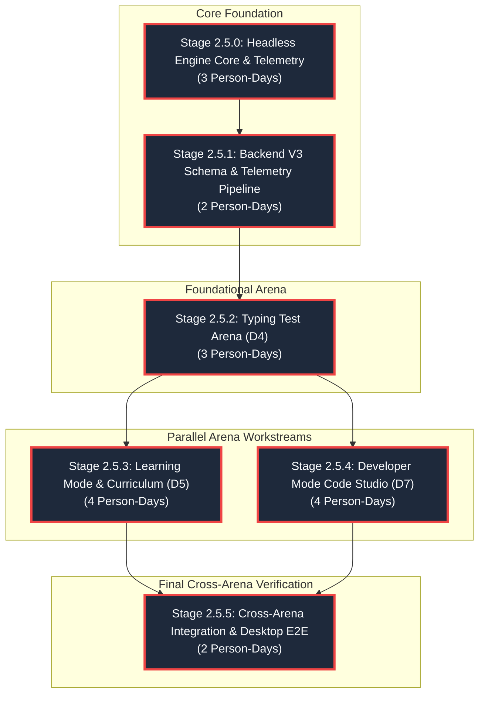

# STAGE 2.5 ARCHITECTURE PLAN: PRACTICE ARENAS
## System Architecture, Framework-Independent Typing Engine, Mathematical Metric Invariants, Scoring Consistency, and Arena Modularization

**Project:** Typing Trainer, Windows Desktop Application  
**Phase:** 3  
**Stage:** 2.5 (Practice Arenas: Typing Test, Learning Mode, Developer Mode)  
**Approved Baseline Commit:** `691c7b132c78ada8be9201852798ee993716ccde`  
**Execution Mode:** Architecture and Execution Planning Only (Implementation Authorization NOT GRANTED)  
**Author:** Antigravity (Lead Engineer)  
**Product Owner:** Fairoz  

---

## 1. Architectural Baseline & Core Principles

The architecture for Stage 2.5 enforces four non-negotiable architectural principles:
1. **Framework-Independent Engine Core:** The mathematical calculation core, keystroke classification logic, and session state machine are decoupled entirely from React, Zustand, DOM, and Tauri webview APIs. The core exists as pure TypeScript modules with zero external dependencies.
2. **Local-First Zero-Latency Interaction:** Keystroke processing, character comparison, buffer corrections, and metric calculations run entirely on the client at hardware polling speed (< 1 ms latency). No network or database calls occur during live typing.
3. **Canonical Scoring Consistency:** All three practice arenas (Typing Test D4, Learning Mode D5, Developer Mode D7) execute the exact same canonical calculation engine and Backspace invariant without arena-specific scoring forks.
4. **Atomic Session Persistence:** Session completion persists session metadata, telemetry samples, XP rewards, and learning progress in a single atomic database transaction on local SQLite.

---

## 2. Framework-Independent Typing Engine Architecture (Issue A)

### 2.1 Layered Engine Topology
The typing engine is architected in three strictly separated tiers:

```
+-----------------------------------------------------------------------------------+
| TIER 3: ARENA UI ADAPTERS & PRESENTATION (React 18 + Tailwind + shadcn/ui)         |
| • Typing Test Arena (SCR-202): 3-line rolling paragraph, liquid caret, pace car    |
| • Learning Mode Arena (SCR-303): Single-key drills, metronome cue, finger visualizer|
| • Developer Mode Arena (SCR-603): 5-line syntax canvas, accessible tokens, indent |
+-----------------------------------------+-----------------------------------------+
                                          |
                                          v
+-----------------------------------------------------------------------------------+
| TIER 2: REACT / ZUSTAND STATE BINDINGS (desktop/src/features/typing-engine/)      |
| • useTypingEngineStore: Zustand store wrapping core engine states                  |
| • useKeystrokeCapture: DOM keyboard event listener, tabIndex focus management     |
| • useMonotonicTimer: React hook binding performance.now() to 250ms render ticker  |
+-----------------------------------------+-----------------------------------------+
                                          |
                                          v
+-----------------------------------------------------------------------------------+
| TIER 1: PURE ENGINE CORE (Headless TypeScript, ZERO Framework / DOM Dependencies) |
| • metricCalculator.ts: Pure calculation functions (Gross WPM, Net WPM, Accuracy) |
| • typingStateMachine.ts: Deterministic transitions (IDLE, RUNNING, PAUSED, etc.) |
| • keystrokeClassifier.ts: Hardware key event taxonomy & modifier filter           |
| • telemetryCollector.ts: Per-stroke latency, initial error attribution            |
+-----------------------------------------------------------------------------------+
```

---

## 3. Canonical Scoring Formulas & Worked Invariant Examples (Issue B & Issue 5)

### 3.1 Standardized Metric Formulas
In standardized touch-typing measurement:
$$\mathbf{1\text{ Word} \equiv 5\text{ Keystrokes}}$$

1. **Gross WPM (Raw Mechanical Speed):**
   $$\mathbf{GrossWPM = \frac{N_{total} / 5}{t_{active\_minutes}}}$$
   where $N_{total} = N_{correct} + N_{incorrect}$.
   - **Backspace Invariant:** Backspaces **never increment $N_{total}$** and **never contribute to Gross WPM**.

2. **Net WPM (Official Benchmark Standard):**
   $$\mathbf{NetWPM = \max\left(0, \frac{(N_{total} / 5) - E_{uncorrected}}{t_{active\_minutes}}\right)}$$
   - **The Error Penalty:** Each uncorrected error ($E_{uncorrected}$) left in the submitted text assesses a **5-keystroke (1-word) penalty** against gross words.
   - **Zero-Floor Rule:** Net WPM cannot be negative. If penalty exceeds gross words, Net WPM is floored at $\mathbf{0.0\text{ WPM}}$.

3. **Keystroke Accuracy Percentage:**
   $$\mathbf{Accuracy\% = \left(\frac{N_{correct}}{N_{total}}\right) \times 100 = \left(\frac{N_{correct}}{N_{correct} + N_{incorrect}}\right) \times 100}$$

4. **Consistency Percentage:**
   $$\mathbf{Consistency\% = \max\left(0, 100 - (\sigma_{\text{wpm\_chunks}} \times 2.5)\right)}$$
   where $\sigma_{\text{wpm\_chunks}}$ is the standard deviation across consecutive 1-second Net WPM intervals.

---

### 3.2 Canonical Scoring Worked Examples (Issue 5)

#### Example 1: Clean Typing
- **Input Text:** Target `"speed"` ($5\text{ characters}$).
- **Typist Actions:** Types `s`, `p`, `e`, `e`, `d` in $6.0\text{ seconds}$ ($0.1\text{ minutes}$) with zero errors.
- **Metrics Evaluation:**
  - $N_{correct} = 5$, $N_{incorrect} = 0$, $N_{total} = 5$.
  - $E_{uncorrected} = 0$.
  - $\text{Gross WPM} = \frac{5 / 5}{0.1} = \mathbf{10.0\text{ WPM}}$.
  - $\text{Net WPM} = \frac{(5 / 5) - 0}{0.1} = \mathbf{10.0\text{ WPM}}$.
  - $\text{Accuracy} = \left(\frac{5}{5}\right) \times 100 = \mathbf{100.0\%}$.

#### Example 2: Corrected Errors (Why Corrected Errors Affect Accuracy but Not Net WPM)
- **Input Text:** Target `"speed"` ($5\text{ characters}$).
- **Typist Actions:** Types `s`, `p`, `x` (error!), `Backspace`, `e`, `e`, `d` in $6.0\text{ seconds}$ ($0.1\text{ minutes}$).
- **Metrics Evaluation:**
  - $N_{correct} = 5$ (`s`, `p`, `e`, `e`, `d`).
  - $N_{incorrect} = 1$ (`x`).
  - $N_{total} = 5 + 1 = 6\text{ character stroke attempts}$. (Backspace erases `x` but does NOT increment $N_{total}$).
  - $E_{uncorrected} = 0$ (error was successfully corrected before word commitment).
  - $\text{Gross WPM} = \frac{6 / 5}{0.1} = \frac{1.2}{0.1} = \mathbf{12.0\text{ WPM}}$.
  - $\text{Net WPM} = \frac{(6 / 5) - 0}{0.1} = \frac{1.2}{0.1} = \mathbf{12.0\text{ WPM}}$ (**Zero word penalty assessed!**).
  - $\text{Accuracy} = \left(\frac{5}{6}\right) \times 100 = \mathbf{83.3\%}$.
  - **Explanation:** Corrected mistakes **DO reduce Accuracy** (from 100% to 83.3%) because $N_{total}$ includes the initial mis-stroke. However, they **DO NOT penalize Net WPM** because $E_{uncorrected} = 0$. Diagnostic telemetry records key `e` with 1 opportunity, 1 error for D6.

#### Example 3: Uncorrected Errors (5-Stroke Word Penalty)
- **Input Text:** Target `"speed"` ($5\text{ characters}$).
- **Typist Actions:** Types `s`, `p`, `e`, `e`, `x` in $6.0\text{ seconds}$ ($0.1\text{ minutes}$) and advances without backspacing.
- **Metrics Evaluation:**
  - $N_{correct} = 4$, $N_{incorrect} = 1$, $N_{total} = 5$.
  - $E_{uncorrected} = 1$.
  - $\text{Gross WPM} = \frac{5 / 5}{0.1} = \mathbf{10.0\text{ WPM}}$.
  - $\text{Net WPM} = \max\left(0, \frac{(5 / 5) - 1}{0.1}\right) = \max\left(0, \frac{1.0 - 1.0}{0.1}\right) = \mathbf{0.0\text{ WPM}}$ (**Full 5-stroke word penalty assessed!**).
  - $\text{Accuracy} = \left(\frac{4}{5}\right) \times 100 = \mathbf{80.0\%}$.

#### Example 4: Backspacing Across Line Boundaries
- **Scenario:** In multi-line code (D7), typist is at the start of line 2 (line 1 has not been permanently committed) and presses Backspace.
- **Behavior:** Caret retreats to the end of line 1 without incrementing $N_{total}$. If leading whitespace on line 2 was generated via Smart Auto-Advance, Backspace retreats across the entire auto-indent block in a single step without penalty.

#### Example 5: Auto-Indentation (Smart Auto-Advance)
- **Scenario:** In Developer Mode, typist completes line `public void test() {` and presses `Enter`.
- **Behavior:**
  - `Enter` is recorded as 1 character input attempt ($N_{total} += 1$, $N_{correct} += 1$).
  - The editor automatically inserts 4 leading indentation spaces on the new line.
  - **Scoring Invariant:** These 4 auto-indented spaces **DO NOT increment $N_{total}$** and **DO NOT count as user keystrokes**. The typist immediately strokes the first non-whitespace character.

#### Example 6: Tab and Newline Handling
- **Scenario:** User presses `Tab` or `Enter` in the typing arena.
- **Behavior:**
  - Standalone `Tab` is captured with `e.preventDefault()` to prevent losing focus from the typing surface. In manual mode, `Tab` inserts 4 spaces ($N_{total} += 4$). In Smart Auto-Advance mode, `Tab` indents 1 block level.
  - `Newline` (`\n`) is treated as 1 printable character input event ($N_{\text{total}} += 1$, $N_{\text{correct}} += 1$).

---

## 4. Session State Machine & Lifecycle Transitions

```
+--------+       Start Test        +-----------+     3-2-1 Done      +---------+
|  IDLE  | ----------------------> | COUNTDOWN | ------------------> | RUNNING |
+--------+                         +-----------+                     +----+----+
     ^                                                                    |
     |                       Reset Session                                | Esc (Manual Pause)
     +-------------------------------------------------------------+      v
     |                                                             |  +--------+
     |                    Timer Expiry / Passage Complete          |  | PAUSED |
     |                     +---------------------------------------+  +----+---+
     |                     |                                               |
     |                     v                                               | Resume (Esc / Button)
+----+----+        +---------------+                                       |
| ABORTED |        |   COMPLETED   | <-------------------------------------+
+---------+        +---------------+
```

1. **`IDLE`:** Session initialized with target text and duration. Keystroke listener inactive.
2. **`COUNTDOWN`:** Optional 3-second visual countdown.
3. **`RUNNING`:** Keystrokes captured; precision clock running; active character comparison; rolling 250ms metric updates.
4. **`PAUSED`:** Triggered manually via **`Esc`**. Clock frozen; reading canvas blurred; input capture disabled. `Esc` or button click resumes.
5. **`COMPLETED`:** Triggered when monotonic timer expires ($t_{\text{remaining}} \le 0$) or final character of passage is struck. Input locked; final metrics calculated; telemetry packaged; session submitted to API.
6. **`ABORTED`:** Triggered by user reset or navigation away. Memory discarded without persisting corrupt/incomplete data.

---

## 5. Practice Arena Modularization & Safety Invariants

### 5.1 Typing Test Arena (D4)
- **SCR-201 Configuration:** Select duration (15s sprint, 30s, 60s benchmark, 120s marathon) and corpus type (Common Words, Standard Prose, Quotes).
- **SCR-202 Live Interface:** 1100px reading stage, 3-line rolling paragraph layout, liquid caret gliding horizontally, pace car ghost text.
- **SCR-203 Results Scorecard:** Performance quartet, 1-second WPM sparkline, official benchmark badges, Weak-Key recommendations card.

### 5.2 Learning Mode & Touch-Typing Curriculum (D5)
- **SCR-301 Curriculum Roadmap:** 4-module tabs (Home Row, Top Row, Bottom Row, Numbers & Symbols), 8-lesson progression grid (32 lessons total), star cabinet (96 stars max).
- **SCR-302 Lesson Briefing:** Visual mechanical keyboard with home-row anchor keys (F & J homing bumps), anatomical finger reach vectors, target key badges.
- **SCR-303 Interactive Drill Stage:** Metronome pacing audio/visual cues, single-target key drills, word building, sentence flow.
- **SCR-304 Module Capstone Assessment:** Comprehensive assessment requiring $\ge 95\%$ accuracy to unlock the subsequent module.

### 5.3 Developer Mode (The Code Studio) (D7)
- **SCR-601 Language Hub:** 6 approved programming languages (Java, TypeScript, JavaScript, Python, SQL, Rust), aggregate code WPM, symbol accuracy metrics.
- **SCR-602 Catalog & Configurator:** Curated code snippets by difficulty tier, delimiter drills, operator exercises, smart indentation mode toggles.
- **SCR-603 5-Line Monospace Syntax Arena:**
  - Accessible syntax color palette ($\ge 4.5:1$ contrast in both dark and light modes).
  - Smart Auto-Advance: Pressing Enter automatically indents to matching level, omitting redundant spacebar presses.
  - Dotted vertical indent guides.
- **SCR-604 Custom Code Importer & Plaintext Sandbox:**
  - Uploaded code files are strictly treated as **inert plaintext display strings**. No compiler, interpreter, TypeScript compiler API, Node.js `eval()`, `new Function()`, or shell subprocess will ever execute uploaded code.
  - Code lines are rendered as plaintext text nodes wrapped in styled `<span>` elements with static CSS token classes.
  - Enforces the **500 KB raw byte ceiling** upfront (`file.size <= 512,000 bytes`).
  - Strict UTF-8 validation (zero invalid byte sequences).
  - Deterministic Bounded Pagination splits files $> 30$ lines into balanced parts of $\le 20$ lines ($K = \lceil N / 20 \rceil$).
  - 5-Line Canvas renders **only 5 lines at any instant** in DOM ($O(1)$ constant memory).

### 5.4 Native Tauri File Export & Security Boundary (Issue 2 & Issue 3)

To export custom snippets while strictly complying with AGENTS.md Section 9 and SECURITY.md (no unrestricted filesystem access, no shell execution, verifiable user destination intent), the export pipeline is architected as a **Rust-owned save-dialog-and-write operation**:

#### 1. The Frontend-Path Vulnerability & Rust-Owned Resolution
- **The Issue:** Allowing the frontend to supply a filesystem `PathBuf` to a backend write command creates a serious security gap: the backend cannot verify whether that path was chosen by the user in a native dialog or maliciously forged (e.g. attempting to overwrite sensitive local files).
- **The Solution:** The frontend **NEVER provides a filesystem path**. It only passes the snippet payload and filename suggestion:
  ```typescript
  await invoke<{ success: boolean; cancelled: boolean }>('export_snippet_file', {
    defaultFileName: 'bubble_sort',
    extension: 'ts',
    content: codeString
  });
  ```
- Rust owns the entire lifecycle: opening the native dialog, receiving the user's selected path directly from the OS, validating the destination, and executing a safe replacement write.

#### 2. Exact API and Compatible Package Versions
- **Desktop Rust Crate:** `tauri-plugin-dialog = "2"` in `desktop/src-tauri/Cargo.toml`.
- **Core Tauri Framework:** `tauri = { version = "2.12.6" }`.
- **Plugin Initialization:** `.plugin(tauri_plugin_dialog::init())` registered in `desktop/src-tauri/src/lib.rs`.
- **Frontend Core:** `@tauri-apps/api = "^2.1.0"` (uses `invoke` from `@tauri-apps/api/core`). Note: Because Rust owns the dialog, the webview does not require `@tauri-apps/plugin-dialog`.

#### 3. Native Save Dialog Handling in Rust
Rust directly invokes the OS native save dialog using `tauri_plugin_dialog::DialogExt`:
```rust
use tauri_plugin_dialog::DialogExt;

#[tauri::command]
fn export_snippet_file(
    app: tauri::AppHandle,
    default_file_name: String,
    extension: String,
    content: String,
) -> Result<ExportOutcome, String> {
    // 1. Enforce 500 KB limit upfront
    if content.len() > 512_000 {
        return Err("Payload exceeds 500 KB limit".into());
    }

    // 2. Validate requested extension against whitelist
    let allowed = ["ts", "js", "py", "java", "rs", "go", "txt", "json", "sql", "md"];
    let clean_ext = extension.trim_start_matches('.').to_lowercase();
    if !allowed.contains(&clean_ext.as_str()) {
        return Err(format!("Unsupported file extension: {}", clean_ext));
    }

    // 3. Open modal OS native save dialog from Rust
    let filter_name = format!("{} Source (*.{})", clean_ext.to_uppercase(), clean_ext);
    let selected_path = app.dialog()
        .file()
        .set_title("Export Code Snippet")
        .set_file_name(&format!("{}.{}", default_file_name, clean_ext))
        .add_filter(filter_name, &[&clean_ext])
        .add_filter("All Files (*.*)", &["*"])
        .blocking_save_file();

    let dest_path = match selected_path {
        Some(path) => path.into_path().map_err(|e| e.to_string())?,
        None => return Ok(ExportOutcome { success: false, cancelled: true }),
    };

    // 4. Validate destination path
    validate_export_destination(&dest_path, &clean_ext)?;

    // 5. Execute safe write and replacement
    safe_atomic_replace_write(&dest_path, content.as_bytes())?;

    Ok(ExportOutcome { success: true, cancelled: false })
}
```

#### 4. Extension Whitelist & Destination Validation
- **Extension Whitelist:** Strictly restricted to `.ts`, `.js`, `.py`, `.java`, `.rs`, `.go`, `.txt`, `.json`, `.sql`, `.md`.
- **Destination Validation:**
  - If the user-selected path omits the extension, Rust appends `.{clean_ext}`.
  - Rust verifies that `dest_path.extension()` matches `clean_ext`.
  - Rejects root drive writes (`C:\`), system directories (`%WINDIR%`, `C:\Windows\System32`, `C:\Program Files`), and traversal sequences (`..`).

#### 5. Existing-File Behavior & OS Confirmation
- When the user selects an existing file in the Windows native Save File Dialog, Windows automatically prompts:
  *"<Filename> already exists. Do you want to replace it?"*
- If the user selects "No" or "Cancel", `blocking_save_file()` returns `None`, and Rust returns `{ success: false, cancelled: true }`. Zero files are altered.
- Only if the user explicitly confirms replacement does the OS return `Some(path)`.

#### 6. Safe Write & Replacement Strategy (No Atomic `std::fs::write` Claim)
- Direct `std::fs::write` is **not atomic** on Windows and leaves partial or corrupt files if interrupted by a power failure or process termination.
- Rust implements a **safe temporary-sibling and backup replacement pattern**:
  1. Write the payload to a temporary sibling file in the same directory:
     `let temp_path = dest_path.with_extension(format!("tmp.{}", uuid::Uuid::new_v4()));`
  2. Write bytes and flush buffers to persistent storage:
     `let mut file = std::fs::File::create(&temp_path)?; file.write_all(bytes)?; file.sync_all()?;`
  3. Replace destination safely:
     - If `dest_path` exists:
       Rename `dest_path` $\rightarrow$ `dest_path.bak`.
       Rename `temp_path` $\rightarrow$ `dest_path`.
       Remove `dest_path.bak`.
       If temp rename fails, roll back: restore `dest_path.bak` $\rightarrow$ `dest_path`.
     - If `dest_path` does not exist:
       Rename `temp_path` $\rightarrow$ `dest_path`.
  4. Ensure temporary files are cleaned up on error.

#### 7. Required Tauri Capabilities and Permissions
- File: `desktop/src-tauri/capabilities/default.json`.
- Permission: `"dialog:default"` (or `"dialog:allow-save"`).
- Invariant: Zero filesystem write permissions (`@tauri-apps/plugin-fs` or `fs:allow-write-all`) granted to webview.

#### 8. Browser Fallback Specification with Deferred Cleanup
In non-Tauri preview environments (headless Chromium or Vitest component tests):
```typescript
export function exportSnippetBrowserFallback(
  fileName: string,
  extension: string,
  content: string
): void {
  const blob = new Blob([content], { type: 'text/plain;charset=utf-8' });
  const objectUrl = URL.createObjectURL(blob);
  const anchor = document.createElement('a');
  anchor.href = objectUrl;
  anchor.download = `${fileName}.${extension}`;
  anchor.style.display = 'none';
  document.body.appendChild(anchor);
  anchor.click();
  document.body.removeChild(anchor);

  // Deferred cleanup: do NOT revoke synchronously immediately after click(),
  // as asynchronous browser download managers (Chromium/Firefox) may abort if
  // the blob URL is revoked before download stream retrieval begins.
  setTimeout(() => {
    URL.revokeObjectURL(objectUrl);
  }, 60_000);
}
```
- **Cancellation:** Handled cleanly by the browser's native download manager prompt; JS execution remains unaffected.
- **Download Initiation:** Initiated via programmatically triggered anchor click with `style.display = 'none'`.
- **Test Verification:** Tests spy on `URL.createObjectURL`, `URL.revokeObjectURL`, and anchor attributes. Tests assert:
  1. Blob MIME type is `text/plain;charset=utf-8`.
  2. `anchor.download` matches expected filename.
  3. `URL.revokeObjectURL` is NOT invoked synchronously on the same event tick, but is invoked upon timeout.

- **SCR-605 Syntax Analytics Scorecard:** Syntax category error breakdown (Delimiters, Operators, Punctuation, Identifiers, Keywords), code Net WPM, symbol accuracy badge.

---

## 6. End-to-End Dependency Graph (Issue 1)



**Critical Path Statement:** Because Stage 2.5.3 (4 days) and Stage 2.5.4 (4 days) have identical duration and dependencies, **BOTH parallel branches are critical-path branches**. Stage 2.5.5 depends strictly on the successful completion of BOTH stages.
