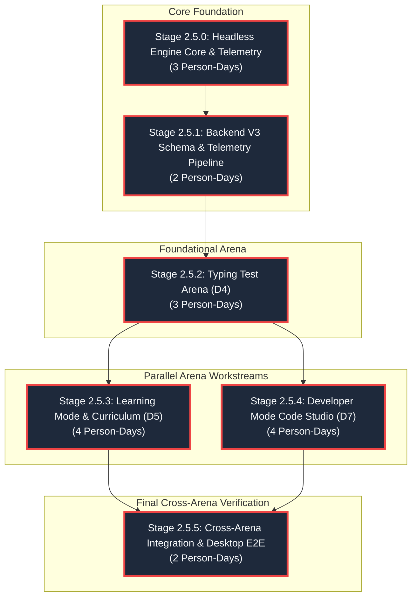

# STAGE 2.5 IMPLEMENTATION BREAKDOWN: PRACTICE ARENAS
## Work Breakdown Structure (WBS), Sequential Dependencies, Critical Path Analysis, and Effort vs Calendar Reconciliation

**Project:** Typing Trainer, Windows Desktop Application  
**Phase:** 3  
**Stage:** 2.5 (Practice Arenas: Typing Test, Learning Mode, Developer Mode)  
**Approved Baseline Commit:** `691c7b132c78ada8be9201852798ee993716ccde`  
**Execution Mode:** Implementation Planning Only (Implementation Authorization NOT GRANTED)  
**Author:** Antigravity (Lead Engineer)  
**Product Owner:** Fairoz  

---

## 1. Effort, Calendar Timeline & Dependency Reconciliation (Issue 1 & Issue G)

### 1.1 Complete Dependency Graph & Critical Path Analysis
Stage 2.5.5 requires the completed implementation of **BOTH Stage 2.5.3 (Learning Mode) AND Stage 2.5.4 (Developer Mode)** to perform multi-arena end-to-end integration and native desktop verification.



**Critical Path Statement:** 
Because Stage 2.5.3 (4 days) and Stage 2.5.4 (4 days) have identical duration and dependencies, **BOTH parallel branches are critical-path branches**. A delay in either branch directly delays Stage 2.5.5.

---

### 1.2 Person-Days of Effort vs Calendar Working Days

```
+-------------------------------------------------------------------------------------------------------+
| SCENARIO A: SINGLE LEAD ENGINEER (Sequential Execution)                                               |
| • Total Effort: 18 Person-Days                                                                        |
| • Total Calendar Duration: 18 Working Days (~3.6 Calendar Weeks)                                      |
| • Schedule:                                                                                           |
|   Days 01–03: Stage 2.5.0 (Headless Engine Core & Telemetry Foundation)                                |
|   Days 04–05: Stage 2.5.1 (Backend V3 Migration & Ingestion Pipeline)                                  |
|   Days 06–08: Stage 2.5.2 (Typing Test Arena D4: SCR-201 to SCR-203)                                  |
|   Days 09–12: Stage 2.5.3 (Learning Mode D5: SCR-301 to SCR-304)                                      |
|   Days 13–16: Stage 2.5.4 (Developer Mode D7: SCR-601 to SCR-605)                                    |
|   Days 17–18: Stage 2.5.5 (Cross-Arena Integration, Desktop Packaging & E2E)                          |
+-------------------------------------------------------------------------------------------------------+

+-------------------------------------------------------------------------------------------------------+
| SCENARIO B: TWO COLLABORATING ENGINEERS (Parallelized Arena Execution)                                 |
| • Total Effort: 18 Person-Days                                                                        |
| • Total Calendar Duration: 14 Working Days (~2.8 Calendar Weeks)                                      |
| • Schedule:                                                                                           |
|   Days 01–03: Stage 2.5.0 (Engine Core) — Shared                                                      |
|   Days 04–05: Stage 2.5.1 (Backend V3 & Ingestion) — Shared                                           |
|   Days 06–08: Stage 2.5.2 (Typing Test Arena) — Shared                                                |
|   Days 09–12: PARALLEL WORKSTREAM:                                                                    |
|               • Engineer 1: Stage 2.5.3 (Learning Mode Curriculum & Drills — 4 Person-Days)           |
|               • Engineer 2: Stage 2.5.4 (Developer Mode Syntax Arena & Importer — 4 Person-Days)       |
|   Days 13–14: Stage 2.5.5 (Integration, Desktop Packaging & E2E Validation) — Shared                 |
+-------------------------------------------------------------------------------------------------------+
```

---

## 2. Sub-Stage Specifications & Backend Responsibility Mapping (Issue 2)

### Stage 2.5.0: Headless Typing Engine Core & Telemetry Foundation
- **Objective:** Build the framework-independent mathematical calculation engine, keystroke classifier, monotonic timer, and telemetry buffer.
- **Scope:**
  - `desktop/src/features/typing-engine/core/metricCalculator.ts`: Pure calculation functions (Gross WPM, Net WPM with 5-stroke word penalty, Accuracy %, Consistency %).
  - `desktop/src/features/typing-engine/core/keystrokeClassifier.ts`: Classifies key events (printable characters vs Backspace vs modifiers).
  - `desktop/src/features/typing-engine/core/telemetryCollector.ts`: Diagnostic initial error attribution and per-key opportunity/latency buffer.
  - `desktop/src/features/typing-engine/core/typingStateMachine.ts`: Deterministic FSM (`IDLE`, `COUNTDOWN`, `RUNNING`, `PAUSED`, `COMPLETED`, `ABORTED`).
  - `desktop/src/features/typing-engine/hooks/useMonotonicTimer.ts`: High-precision monotonic timer.
  - `desktop/src/features/typing-engine/hooks/useKeystrokeCapture.ts`: Scoped DOM input adapter.
  - `desktop/src/features/typing-engine/store/useTypingEngineStore.ts`: Central Zustand engine store.
- **Backend Responsibilities:** None (Pure frontend engine).
- **Effort:** 3 Person-Days.
- **Dependencies:** None.
- **Acceptance Criteria:**
  - Vitest test suite proves mathematical accuracy of Gross WPM, Net WPM, and Accuracy %.
  - Backspace does not increment $N_{\text{total}}$ and does not contribute to Gross/Net WPM.
- **Evidence Required:** Vitest execution log with 100% passing tests.

---

### Stage 2.5.1: Backend Schema Migration (V3) & Telemetry Ingestion Pipeline
- **Objective:** Extend backend database schema and session ingestion to support practice telemetry, curriculum progress, and developer snippets.
- **Scope & Backend Responsibilities (OWNED BY 2.5.1):**
  - **Flyway V3 Migration (`V3__create_practice_arenas_schema.sql`):** Creates `learning_progress`, `developer_snippets`, and `developer_snippet_stats`. Leaves `key_telemetry` untouched. Seeds initial curated snippets.
  - **Telemetry Ingestion Pipeline:** Updates `TypingSessionSubmissionRequest` to accept `List<KeyTelemetryDto>` (max 100 items). Extends `TypingSessionService.submitSession` to batch-persist `KeyTelemetryEntity` rows inside the existing `@Transactional` boundary.
  - **Idempotency & Rollback:** Verifies retry idempotency and all-or-nothing rollback on SQLite.
- **Effort:** 2 Person-Days.
- **Dependencies:** Stage 2.5.0.
- **Acceptance Criteria:**
  - Flyway V3 applies cleanly on fresh SQLite database and upgrades existing V2 database.
  - Submitting a session with key telemetry successfully inserts rows into `key_telemetry`.
  - D6 `RecommendationService` automatically reflects newly persisted telemetry.
- **Evidence Required:** JUnit 5 test suite passing, Flyway migration test passing.

---

### Stage 2.5.2: Typing Test Arena Implementation (D4)
- **Objective:** Implement the complete D4 Typing Test experience (SCR-201, SCR-202, SCR-203).
- **Scope:**
  - `desktop/src/features/typing-test/components/TypingTestConfigurator.tsx` (SCR-201): Durations (15s, 30s, 60s, 120s), corpus selector, pace car toggle.
  - `desktop/src/features/typing-test/components/LiveTypingArena.tsx` (SCR-202): Monospace reading stage, liquid caret, 3-line rolling paragraph display, pause modal on `Esc`.
  - `desktop/src/features/typing-test/components/TypingTestResults.tsx` (SCR-203): Net WPM, Gross WPM, Accuracy, Consistency, 1-second WPM sparkline, official benchmark pill, Weak Key drill CTA.
  - Wire session completion to `POST /api/v1/sessions` and update Dashboard store.
- **Backend Responsibilities (OWNED BY 2.5.2):** Validates live telemetry ingestion from typing test to D6 Weak-Key overview.
- **Effort:** 3 Person-Days.
- **Dependencies:** Stage 2.5.0, Stage 2.5.1.
- **Acceptance Criteria:**
  - Typing test runs smoothly with live metric updates.
  - Completed test generates `TypingSessionSubmissionRequest` with key telemetry.
  - Dashboard W-01, W-02, W-03, W-08, W-09, W-10 instantly reflect test results upon returning to `/dashboard`.
- **Evidence Required:** Component unit tests, visual screenshot capture in dark and light modes.

---

### Stage 2.5.3: Learning Mode & Touch-Typing Curriculum (D5)
- **Objective:** Implement the complete D5 educational curriculum (SCR-301 through SCR-304) and learning progress backend endpoints.
- **Scope & Backend Responsibilities (OWNED BY 2.5.3):**
  - **Backend Services & APIs:** Implements `LearningService` and `LearningController` for `GET /api/v1/learning/progress` and `POST /api/v1/learning/lessons/{id}/complete`.
  - **Star Evaluation Engine:** Evaluates 1 Star (90%), 2 Stars (95%), 3 Stars (98%) on backend, updates `learning_progress`, awards completion XP, and unlocks next lesson.
  - **Frontend Components:**
    - 32-lesson curriculum definition data structure (4 modules × 8 lessons) in frontend constants.
    - `CurriculumRoadmap.tsx` (SCR-301): 4-module tabs, lesson grid, star cabinet (96 stars max).
    - `LessonBriefing.tsx` (SCR-302): Key visualizer, homing anchor cues, anatomical reach lines.
    - `InteractiveDrillStage.tsx` (SCR-303): Single-key drills, word exercises, metronome pacing.
    - `ModuleMasteryAssessment.tsx` (SCR-304): Capstone exam with $\ge 95\%$ accuracy gate.
- **Effort:** 4 Person-Days.
- **Dependencies:** Stage 2.5.0, Stage 2.5.1.
- **Acceptance Criteria:**
  - Star ratings evaluated accurately; locked lessons remain non-interactive until prior lesson is completed.
  - Capstone exam unlocks subsequent module upon passing with $\ge 95\%$ accuracy.
- **Evidence Required:** Unit tests for curriculum progression, MockMvc test suite, screenshot captures.

---

### Stage 2.5.4: Developer Mode (The Code Studio) (D7)
- **Objective:** Implement the complete D7 programming syntax practice studio (SCR-601 through SCR-605) and developer snippet backend endpoints.
- **Scope & Backend Responsibilities (OWNED BY 2.5.4):**
  - **Backend Services & APIs:** Implements `DeveloperSnippetService` and `DeveloperController` for `GET /api/v1/developer/tracks`, `GET /api/v1/developer/tracks/{track}/snippets`, and `POST /api/v1/developer/snippets/import`.
  - **Custom Snippet Processing:** Enforces 500 KB limit, strict UTF-8 validation, and deterministic bounded chunking ($\le 20$ lines per part).
  - **Frontend Components:**
    - `DeveloperModeHub.tsx` (SCR-601): 6 language tracks, aggregate code WPM, symbol accuracy.
    - `ExerciseCatalog.tsx` (SCR-602): Curated snippets, delimiter drills, operator exercises.
    - `SyntaxTypingArena.tsx` (SCR-603): 5-line monospace canvas, syntax color tokens, smart auto-advance on Enter, dotted indent guides.
    - `CustomCodeImporter.tsx` (SCR-604): 500 KB drag-and-drop file upload, deterministic chunking preview, Tauri native save dialog for export.
    - `SyntaxScorecard.tsx` (SCR-605): Category error breakdown (Delimiters, Operators, Punctuation, Identifiers, Keywords).
- **Effort:** 4 Person-Days.
- **Dependencies:** Stage 2.5.0, Stage 2.5.1.
- **Acceptance Criteria:**
  - Smart auto-advance indents cursor automatically on Enter without requiring manual spacebar presses.
  - 500 KB limit enforced strictly upfront; files $> 30$ lines chunked deterministically into balanced $\le 20$-line parts.
  - Tauri native save dialog functions properly for custom snippet export.
- **Evidence Required:** Chunking algorithm unit tests, MockMvc test suite, visual screenshots.

---

### Stage 2.5.5: Cross-Arena Integration, Desktop Packaging & E2E Validation
- **Objective:** Final integration verification across all three practice arenas, dashboard synchronization, and native desktop packaging.
- **Scope:**
  - End-to-end integration tests verifying Dashboard updates after completing each arena.
  - Tauri WebView2 process and token validation under Windows.
  - Playwright automated workflow tests.
  - Documentation reconciliation and formal Stage 2.5 completion report.
- **Backend Responsibilities (OWNED BY 2.5.5):** Final cross-arena regression verification and performance testing.
- **Effort:** 2 Person-Days.
- **Dependencies:** Stages 2.5.0, 2.5.1, 2.5.2, **AND BOTH 2.5.3 AND 2.5.4**.
- **Acceptance Criteria:**
  - 100% passing tests across frontend Vitest, backend JUnit 5, and Playwright E2E.
  - Native Windows desktop application compiles cleanly and operates offline.
- **Evidence Required:** Full test execution output, Playwright test logs, native desktop window captures.
